<div align="center">

<h1>enban</h1>

<strong>CD、DVD、Blu-ray ディスクの書き込み、読み込み、イメージ作成、検証を、ターミナルのフルスクリーンアプリで行います。</strong>

[English](README.md) | 日本語 | [简体中文](README.zh-Hans.md) | [繁體中文 (香港)](README.zh-HK.md)

[](https://github.com/gufranco/enban/actions/workflows/ci.yml)
[](LICENSE)

<p align="center">
  <a href="#quick-start"><strong>クイックスタート</strong></a> |
  <a href="#how-it-works">仕組み</a> |
  <a href="#development">開発</a>
</p>

</div>

`enban`、円盤は、ディスクを意味する日本語です。ディスク書き込みソフトの仕事をターミナルで行います。イメージの書き込み、ファイルからのイメージ作成、ディスクからイメージへのコピー、ディスクとイメージの照合、ドライブの負荷テストです。フルスクリーンアプリでも、スクリプト向けの普通のコマンドでも使え、Linux と macOS で動きます。

---

<p align="center">
  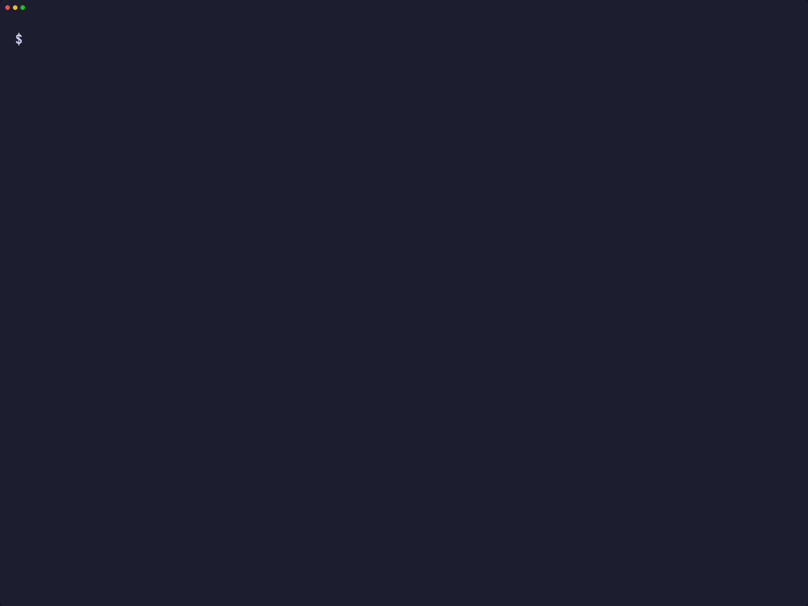
</p>

```console
$ enban doctor
gum                ok       /opt/homebrew/bin/gum
dd                 ok       /opt/homebrew/opt/coreutils/libexec/gnubin/dd, gnu 9.12
cmp                ok       /opt/homebrew/opt/diffutils/bin/cmp, gnu 3.12
od                 ok       /opt/homebrew/opt/coreutils/libexec/gnubin/od, gnu 9.12
awk                ok       /opt/homebrew/opt/gawk/libexec/gnubin/awk, gnu 5.4.1
sed                ok       /opt/homebrew/opt/gnu-sed/libexec/gnubin/sed, gnu 4.10
head               ok       /opt/homebrew/opt/coreutils/libexec/gnubin/head, gnu 9.12
tr                 ok       /opt/homebrew/opt/coreutils/libexec/gnubin/tr, gnu 9.12
stat               ok       /opt/homebrew/opt/coreutils/libexec/gnubin/stat, gnu 9.12
sudo               ok       /usr/bin/sudo
hdiutil            ok       /usr/bin/hdiutil
xorriso            ok       /opt/homebrew/bin/xorriso
shasum             ok       /opt/homebrew/bin/shasum
cdrecord           ok       /opt/homebrew/bin/cdrecord
readcd             ok       /opt/homebrew/bin/readcd
mkisofs            ok       /opt/homebrew/bin/mkisofs
cdrdao             ok       /opt/homebrew/bin/cdrdao
dvd+rw-booktype    ok       /opt/homebrew/bin/dvd+rw-booktype
bchunk             ok       /opt/homebrew/bin/bchunk
iat                ok       /opt/homebrew/bin/iat
ffmpeg             ok       /opt/homebrew/bin/ffmpeg
```

<a id="quick-start"></a>

## クイックスタート

### 前提条件

| ツール | 用途 | インストール |
|:-----|:----|:--------|
| [`gum`](https://github.com/charmbracelet/gum) | doctor、version、help のファミリー共通の見た目 | `brew install gum` |
| POSIX `sh`、`stty`、`dd`、`od`、`awk` | アプリとキー入力の読み取り | macOS と Linux に標準搭載 |
| `hdiutil` | macOS でのイメージのマウント | 標準搭載 |
| `xorriso` | イメージ、ドライブ代わりのイメージ、Linux でのドライブ | `brew install xorriso` |
| cdrtools の `cdrecord`、`readcd`、`mkisofs`、macOS で使用 | macOS での実ドライブ、音楽 CD、UDF と DVD Video のイメージ | `brew install cdrtools` |
| `cdrdao`、`dvd+rw-tools`、`bchunk`、`iat`、macOS では任意 | Linux と同じく、CD の生読み、ブックタイプ、イメージ変換 | `brew install cdrdao dvd+rw-tools bchunk iat` |
| `ffmpeg`、任意 | FLAC、MP3、OGG、M4A などからの音楽 CD | `brew install ffmpeg` または `apt install ffmpeg` |
| `xorriso` と `cdrskin`、任意で `cdrdao`、`genisoimage`、`sg3-utils`、`dvd+rw-tools`、`bchunk`、`iat`、`udisks2` | Linux でのドライブとイメージ。genisoimage は UDF イメージ、sg3-utils はクローズ、速度、リージョン、生セクター、dvd+rw-tools はブックタイプ、bchunk と iat はイメージ変換、udisks2 はマウント用 | `apt install xorriso cdrskin cdrdao genisoimage sg3-utils dvd+rw-tools bchunk iat udisks2` |

### インストール

```bash
git clone https://github.com/gufranco/enban.git
cd enban
make install
```

`make install` はツール、man ページ、bash・zsh・fish の補完を `~/.local` の下にコピーし、`enban` を `~/.local/bin` に置きます。場所は `PREFIX` で変えられます。

### 確認

`enban doctor` は、上の例のように、すべてのツールとそのインストール状況を表示します。

## 使い方

| コマンド | 用途 |
|:--------|:--------|
| `enban --drive /dev/sr0` | そのドライブのディスクを右側に表示してフルスクリーンアプリを開きます。`ENBAN_DRIVE` でもドライブを指定できます |
| `enban info --drive /dev/sr0` | ドライブと中のディスクを説明します。`--json` はスクリプト向けに 1 つのオブジェクトを出力します |
| `enban write image.iso --drive /dev/sr0` | ドライブ名を入力するとイメージを書き込み、読み戻して照合し、取り出します |
| `enban read --drive /dev/sr0 backup.iso` | ディスクを新しいイメージにコピーし、MD5 と SHA-256 を表示します |
| `enban verify --drive /dev/sr0 debian.iso` | ディスクの全セクターをイメージと照合するか、各セクターが読めるかだけを確認します |
| `enban build ~/Photos/2009 family.iso` | フォルダーから ISO9660、Joliet、UDF のイメージを作ります |
| `enban erase --drive /dev/sr0` | ドライブ名を入力すると書き換え可能なディスクを消去します |
| `enban queue family.queue` | イメージの一覧を書き込みます。各ドライブが自分の分を順に処理します |
| `enban discovery --drive /dev/sr0` | 空のディスクをパターンで埋め、読み戻して読み込み速度を保存します |
| `enban doctor` | enban が必要とするツールとそのインストール状況を表示します |

enban はほかに、イメージの変換とラベル変更、CUE シートと音楽 CD の書き込み、セッションのクローズ、セクターとレイヤーブレークの表示、ドライブのリージョン、ブックタイプ、機能の読み取りもします。すべてのコマンド、オプション、キーは `man enban` に、同じ概要は `enban help` にあります。

macOS では実ドライブを `IODVDServices/0` や `IOCompactDiscServices/0` のように指定し、cdrtools の `cdrecord` と `readcd` を通して扱います。どこでもイメージファイルを `--drive stdio:disc.iso` としてドライブの代わりに使えます。`region` と `close --track` だけは、macOS に届くコマンドがないため、まだ Linux が必要です。

### アプリ

| キー | 動作 |
|:----|:-----|
| 矢印、Enter | 作業や項目の間を移動し、タブを開くか項目を編集します |
| スペース | 選択中のスイッチをオンまたはオフにします |
| Tab、`0` から `9` | 次のタブへ、または特定のタブへ直接移動します |
| `c` | `y` と答えると実行中の作業を取り消します |
| `?` | キー一覧を表示します。各タブの最終行にもそのタブのキーが出ます |
| `q` または Ctrl+D | 終了してターミナルを戻します。作業の実行中は受け付けません |

### 設定とテーマ

Settings タブは既定値を Write、Read、Build、Queue、Events、Look のページに分け、`~/.config/enban/settings` に 1 行 1 つの `name=value` で保存します。オプション、次に `ENBAN_` 変数がファイルより優先されます。色は `--theme`、`ENBAN_THEME`、`KODOUGU_THEME` で選び、`NO_COLOR` で色をなくせます。enban はファミリー共通のコマンドラインの約束に従います。詳しくは [FAMILY.md](FAMILY.md) を参照してください。

<a id="how-it-works"></a>

## 仕組み

gum は 1 プロセスに 1 つのウィジェットを描き、イベントループを持ちません。そのため enban は自前のループを回し、gum は項目を編集する場面だけに使います。

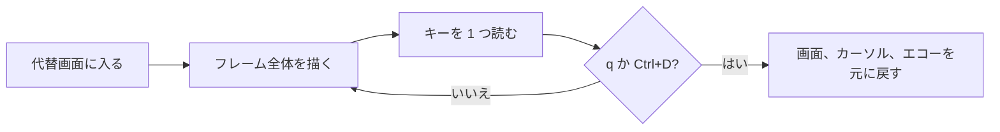

- フレームはテーマの色のエスケープシーケンスで描きます。140 桁で両ペインを含むフレーム全体の描画は、作者の Mac でほかのテストが動いている間に 77 ms で、予算は 250 ms です。モックアップで各ボックスを gum で描いたときは 524 ms でした。
- 100 桁未満では作業とディスクのペインが縦に並び、6 つの作業は 1 つのリストになります。
- キーは `dd` で 1 バイトずつ読み、16 進数から解読するので、矢印、Escape、Enter、Ctrl+D を区別できます。
- ターミナルは `q`、Ctrl+D、割り込みのときに元に戻ります。macOS の GNU `stty` はエコーを戻すときに偽の失敗を報告するため、enban は自分で `stty -a` を確認し、入力が本当に隠れたままのときだけ警告します。
- ターミナルがなければアプリは開かず、enban は問題を伝えて 1 で終了します。

<a id="portability"></a>

## 移植性

すべて POSIX `sh` で書かれ、ShellCheck `-o all` の指摘はゼロです。テストは `script` による疑似端末でアプリを操作し、[FAMILY.md](FAMILY.md) のすべてのシェルとツールセットで動きます。

<a id="screens"></a>

## 画面

<details>
<summary><code>make screens</code> で実際の実行から記録したすべての画面</summary>
<br>

<table>
<tr>
<td width="50%" valign="top">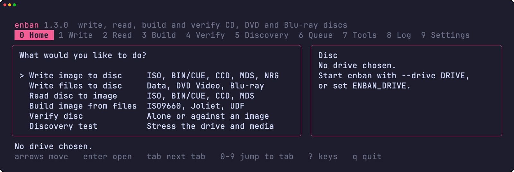<br><sub>Home。6 つの作業とディスクのペイン</sub></td>
<td width="50%" valign="top">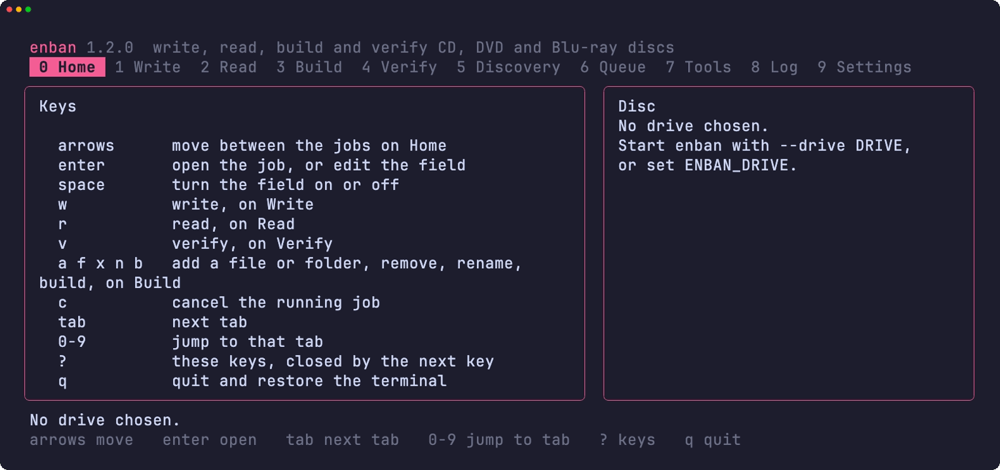<br><sub>? で開くキー一覧</sub></td>
</tr>
<tr>
<td width="50%" valign="top">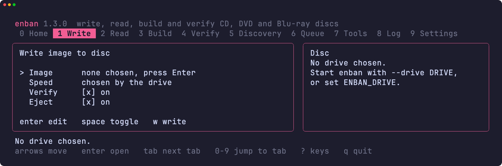<br><sub>Write タブ。イメージ、速度、部数、スイッチ</sub></td>
<td width="50%" valign="top">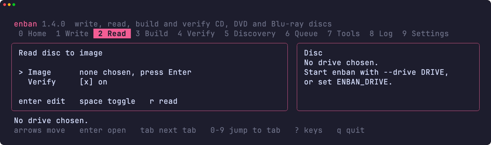<br><sub>Read タブ。イメージと検証の項目</sub></td>
</tr>
<tr>
<td width="50%" valign="top">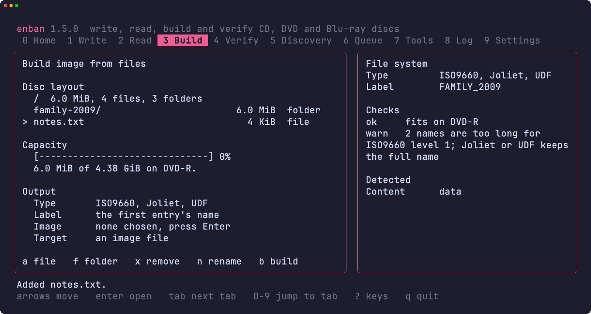<br><sub>Build タブ。ディスクの構成、容量、出力項目、ファイルシステムの確認</sub></td>
<td width="50%" valign="top">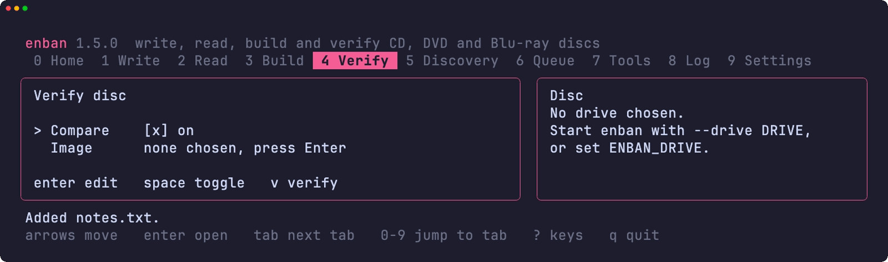<br><sub>Verify タブ。照合とイメージの項目</sub></td>
</tr>
<tr>
<td width="50%" valign="top">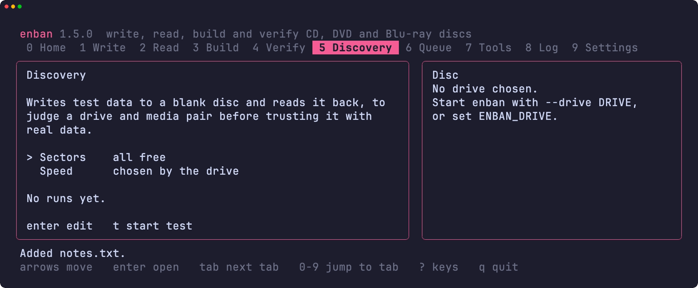<br><sub>Discovery タブ。セクター数と速度の項目</sub></td>
<td width="50%" valign="top">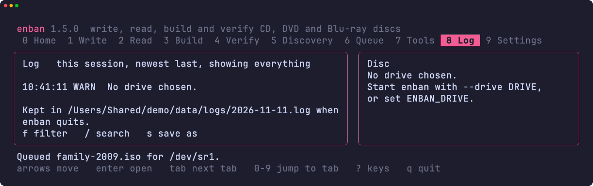<br><sub>Log タブ。このセッションの記録</sub></td>
</tr>
<tr>
<td width="50%" valign="top">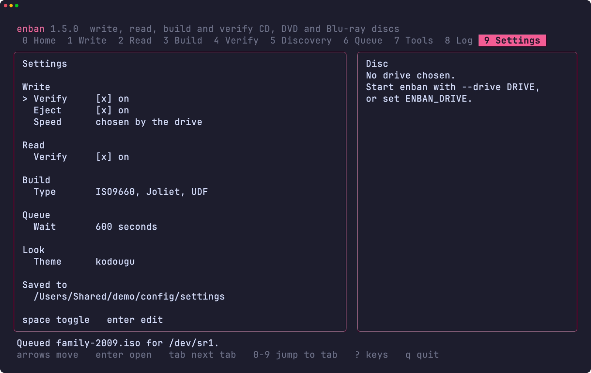<br><sub>Settings タブの Write ページ</sub></td>
<td width="50%" valign="top"></td>
</tr>
<tr>
<td width="50%" valign="top">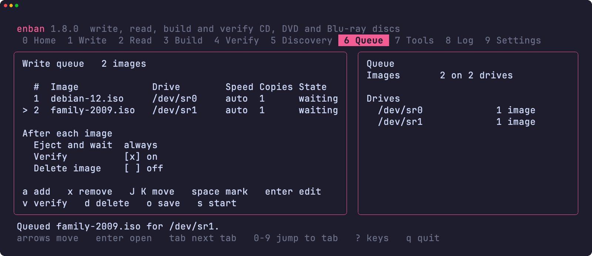<br><sub>Queue タブ。ドライブを待つ 2 つのイメージ</sub></td>
<td width="50%" valign="top">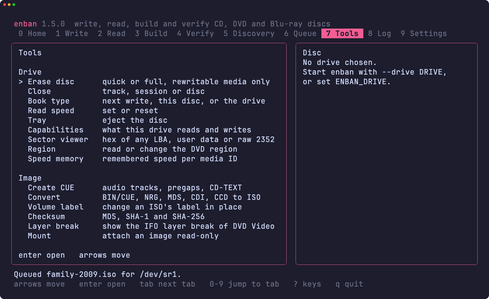<br><sub>Tools タブ。ドライブとイメージのツール</sub></td>
</tr>
<tr>
<td width="50%" valign="top">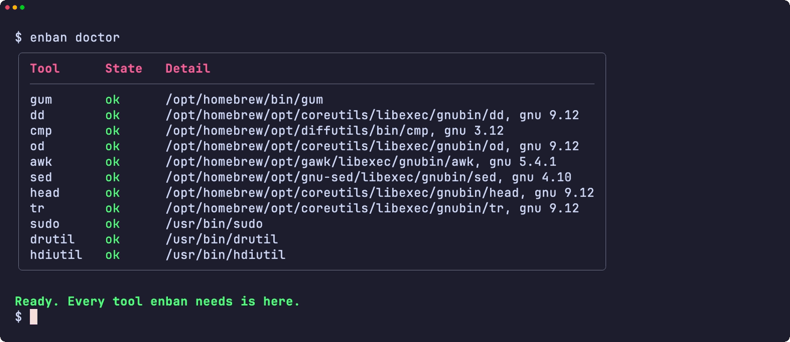<br><sub>doctor が必要なツールをすべて確認</sub></td>
<td width="50%" valign="top">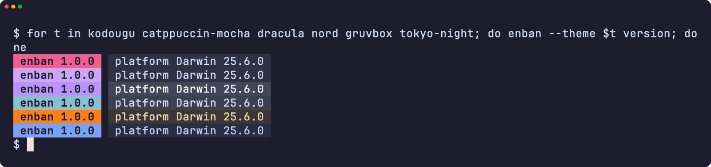<br><sub>6 つのテーマでのバージョン表示</sub></td>
</tr>
<tr>
<td width="50%" valign="top">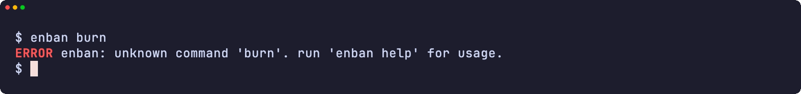<br><sub>エラー</sub></td>
<td width="50%" valign="top">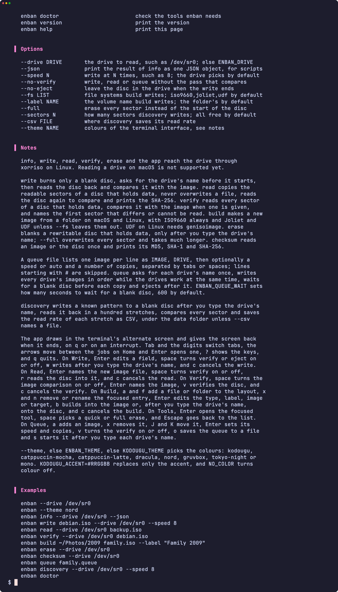<br><sub>ヘルプページ</sub></td>
</tr>
</table>

</details>

<a id="development"></a>

## 開発

| コマンド | 説明 |
|:--------|:------------|
| `make fmt` | shfmt ですべてのスクリプトを整形します |
| `make lint` | shfmt、すべてのスクリプト・テスト・補完への ShellCheck、man ページへの mandoc、ワークフローへの yamllint と actionlint |
| `make test` | システムの `sh` で `bats` テストを実行します |
| `make test-all` | すべてのシェルで同じテストを実行します |
| `make test-linux` | Ubuntu コンテナーで同じテストを実行します |
| `make coverage` | この Mac と Ubuntu コンテナーでの bashcov の行カバレッジを合わせ、CI と同じ 100% の基準で確認します |
| `make screens` | macOS で VHS を使い、実際のツールから README の画面を記録します |

## ライセンス

[MIT](LICENSE)
