<div align="center">

<h1>enban</h1>

<strong>Write, read, build and verify CD, DVD and Blu-ray discs in a full-screen terminal app.</strong>

[](https://github.com/gufranco/enban/actions/workflows/ci.yml)
[](LICENSE)

<p align="center">
  <a href="#quick-start"><strong>Quick start</strong></a> |
  <a href="#how-it-works">How it works</a> |
  <a href="#development">Development</a>
</p>

</div>

`enban`, 円盤, is Japanese for a disc. It aims at the jobs a disc burner does: write an image, write files, read a disc to an image, build an image, verify a disc against an image, and stress-test a drive. Today it ships the app, with its Write, Read, Build, Verify, Discovery, Queue and Tools tabs, and the plain commands `info`, `write`, `read`, `verify`, `build`, `erase`, `checksum`, `queue` and `discovery` for scripts. Work on a drive runs on Linux; building an image and checking an image's checksums also run on macOS. The log and settings, the raw drive tools, and audio CDs arrive in the coming releases, each as a tab and as a plain command.

---

<p align="center">
  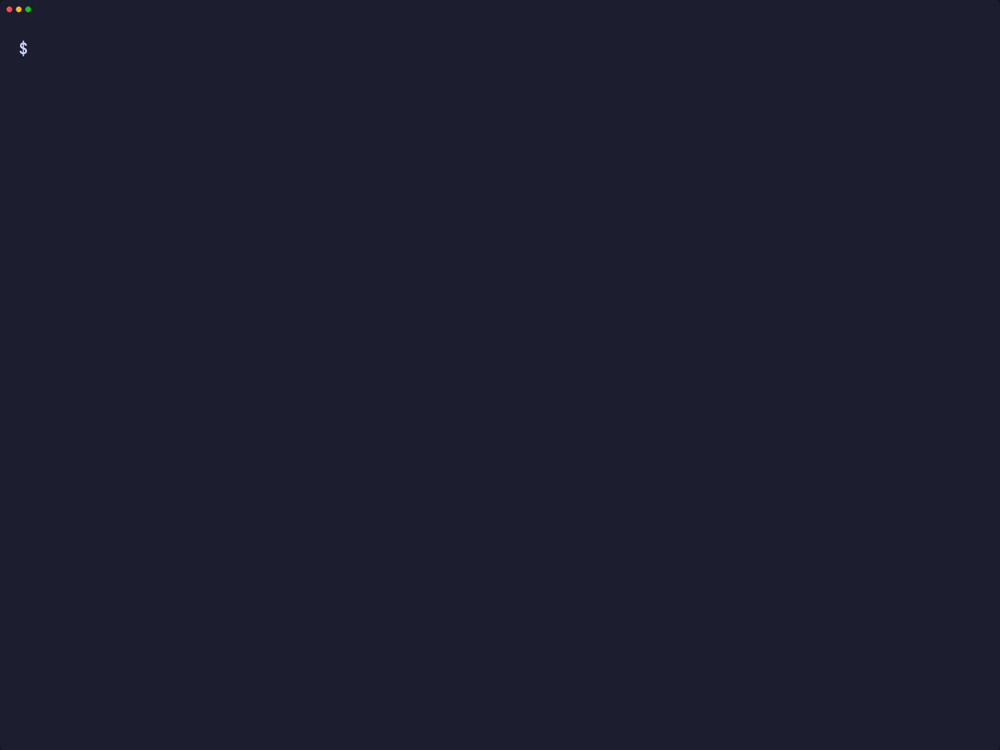
</p>

```console
$ enban doctor
gum                ok       /opt/homebrew/bin/gum
dd                 ok       /opt/homebrew/opt/coreutils/libexec/gnubin/dd, gnu 9.12
cmp                ok       /opt/homebrew/opt/diffutils/bin/cmp, gnu 3.12
od                 ok       /opt/homebrew/opt/coreutils/libexec/gnubin/od, gnu 9.12
awk                ok       /opt/homebrew/opt/gawk/libexec/gnubin/awk, gnu 5.4.1
sed                ok       /opt/homebrew/opt/gnu-sed/libexec/gnubin/sed, gnu 4.10
head               ok       /opt/homebrew/opt/coreutils/libexec/gnubin/head, gnu 9.12
tr                 ok       /opt/homebrew/opt/coreutils/libexec/gnubin/tr, gnu 9.12
sudo               ok       /usr/bin/sudo
drutil             ok       /usr/bin/drutil
hdiutil            ok       /usr/bin/hdiutil
```

<a id="quick-start"></a>

## Quick start

### Prerequisites

| Tool | Why | Install |
|:-----|:----|:--------|
| [`gum`](https://github.com/charmbracelet/gum) | The family look for doctor, version and help | `brew install gum` |
| POSIX `sh`, `stty`, `dd`, `od`, `awk` | The app and its key reading | Preinstalled on macOS and Linux |
| `drutil` and `hdiutil` | The drive and images on macOS | Preinstalled |
| `xorriso` and `cdrskin`, optionally `cdrdao` and `genisoimage` | The drive and images on Linux; genisoimage only for UDF images | `apt install xorriso cdrskin cdrdao genisoimage` |

### Install

```bash
git clone https://github.com/gufranco/enban.git
cd enban
make install
```

`make install` copies the tool, its man page and its bash, zsh and fish completions under `~/.local`, and puts `enban` in `~/.local/bin`; set `PREFIX` to change that.

### Verify

`enban doctor` lists every tool and whether it is installed, as in the sample above.

## Usage

| Command | Purpose |
|:--------|:--------|
| `enban --drive /dev/sr0` | Open the full-screen app on a terminal, with the disc in that drive on the right; `ENBAN_DRIVE` sets the drive too |
| `enban info --drive /dev/sr0` | Describe the drive and the disc: profile, blank or appendable, sessions, free sectors, write speeds and the kinds of disc the drive handles. `--json` prints one object for scripts. Linux only for now |
| `enban write image.iso --drive /dev/sr0` | Burn the image to a blank disc once you type the drive's name, read it back to compare, then eject. `--speed 8`, `--no-verify` and `--no-eject` change that. Linux only for now |
| `enban read --drive /dev/sr0 backup.iso` | Copy the disc into a new image file, read it again to compare, and print the SHA-256. `--no-verify` skips the second read. Linux only for now |
| `enban verify --drive /dev/sr0 debian.iso` | Read every sector of the disc and compare it with the image, naming the first sector that differs or cannot be read. Leave out the image to only check that every sector reads. Linux only for now |
| `enban build ~/Photos/2009 family.iso` | Make an image from a folder with ISO9660, Joliet and UDF, named after the folder. `--fs iso9660,joliet` leaves UDF out, and `--label "Family 2009"` names the volume. Works on macOS and Linux |
| `enban erase --drive /dev/sr0` | Blank a rewritable disc once you type the drive's name. `--full` overwrites every sector instead of only the start. Linux only for now |
| `enban checksum family.iso`, `enban checksum --drive /dev/sr0` | Read an image or the disc once and print its MD5, SHA-1 and SHA-256. The disc form is Linux only for now |
| `enban queue family.queue` | Write the images a queue file lists, one per line as an image, a drive, an optional speed and copy count. Each drive works through its images in order while the drives run at the same time; enban waits for a blank disc before each copy, `ENBAN_QUEUE_WAIT` seconds at most. Linux only for now |
| `enban discovery --drive /dev/sr0` | Fill a blank disc with a known pattern once you type the drive's name, read every sector back and save the read rate as CSV, under `ENBAN_DATA` unless `--csv` names a file. `--sectors` limits how much it writes and `--speed` sets the write speed. Linux only for now |
| `enban doctor` | List the tools enban needs and whether they are installed |
| `enban version`, `enban help` | Print the version or the full usage page |

| Key | In the app |
|:----|:-----------|
| Arrows | Move between the six jobs on Home, or the rows and fields on Write, Read, Build and Verify |
| Enter | Open the focused job's tab, or edit the focused field |
| Space | Turn verify or eject on or off on Write, verify on Read, or the image comparison on Verify |
| `v` on Queue | Turn the verify after each image on or off |
| `w` | Write the chosen image, after you type the drive's name |
| `r` | Read the disc into the chosen new file |
| `v` | Verify the disc, against the chosen image or alone |
| `a`, `f` | Add a file or a folder to the disc layout on Build; `a` adds an image on Queue |
| `x`, `n` | Remove or rename the focused entry on Build; `x` removes the focused image on Queue |
| `J`, `K` | Move the focused image down or up the queue on Queue |
| `o`, `s` | Save the queue to a file, or start it after you type each drive's name, on Queue |
| `t` | Start a discovery test after you type the drive's name, on Discovery |
| `b` | Build the layout into the chosen image file, or burn it to the disc when Target says so, after you type the drive's name |
| `c` | Cancel the running job |
| Esc | Leave a tool's panel for the tool list on Tools |
| Tab | Next tab |
| `0` to `9` | Switch to that tab |
| `?` | Show the keys; the next key closes them |
| `q` or Ctrl+D | Quit and give the terminal back; refused while a job runs |

`--theme <name>` picks the colours; `ENBAN_THEME`, then `KODOUGU_THEME`, set the same, and `NO_COLOR` turns colour off.

Defaults can live in a settings file, `~/.config/enban/settings` or `ENBAN_CONFIG/settings`, one `name=value` per line: `write_verify`, `write_eject` and `read_verify` take `yes` or `no`, `write_speed` takes `auto` or a number, `build_fs` a list such as `iso9660,joliet`, `queue_wait` seconds, and `theme` a theme name. An option, then an `ENBAN_` variable, wins over the file, and `--verify` or `--eject` turn back on what the file turned off. enban follows the shared command-line contract of its family, described in [FAMILY.md](FAMILY.md).

<a id="how-it-works"></a>

## How it works

gum draws one widget per process and has no event loop, so enban runs its own loop and keeps gum for the moments a field is edited.

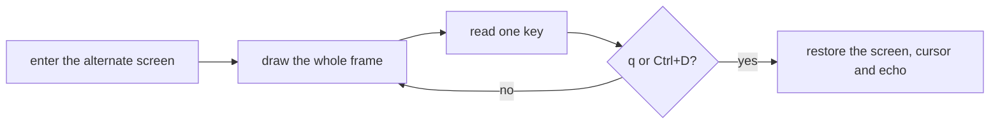

- The frame is drawn with escape sequences in the theme's colours. A full frame at 140 columns, with both panes, took 77 ms on the owner's Mac while other test suites ran, against a budget of 250 ms; drawing each box through gum took 524 ms in the mockups.
- Below 100 columns the jobs and the disc pane stack, and the six jobs become one list.
- Keys are read one byte at a time with `dd` and decoded from hex, so arrows, Escape, Enter and Ctrl+D are told apart.
- The terminal is restored on `q`, on Ctrl+D and on an interrupt. GNU `stty` on macOS reports a false failure when echo is turned back on, so enban checks `stty -a` itself and warns only when typing is really still hidden.
- Without a terminal the app never opens; enban names the problem and exits 1.

<a id="portability"></a>

## Portability

Everything is POSIX `sh` with ShellCheck `-o all` at zero findings. The suites drive the app through a pseudo-terminal with `script`, under every shell and toolset in [FAMILY.md](FAMILY.md).

<a id="screens"></a>

## Screens

<details>
<summary>Every screen, recorded from a real run with <code>make screens</code></summary>
<br>

<table>
<tr>
<td width="50%" valign="top">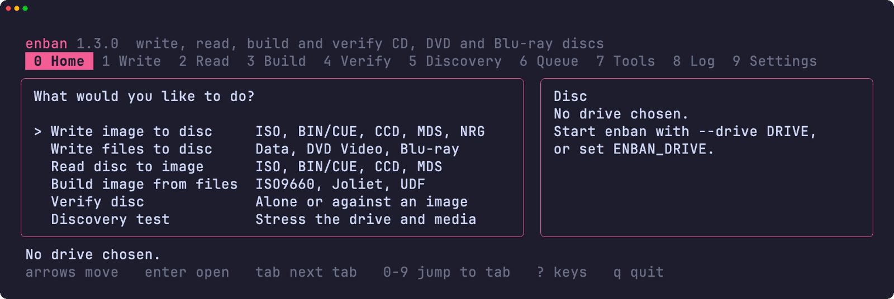<br><sub>Home, with the six jobs and the disc pane</sub></td>
<td width="50%" valign="top">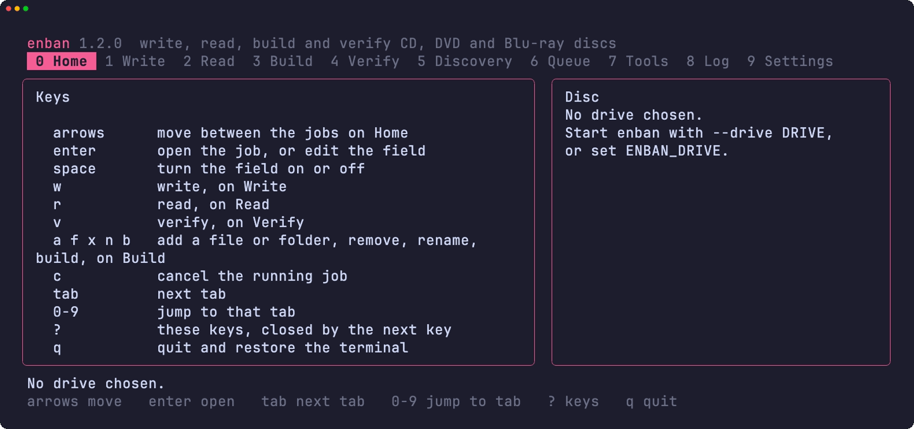<br><sub>The key list that ? opens</sub></td>
</tr>
<tr>
<td width="50%" valign="top">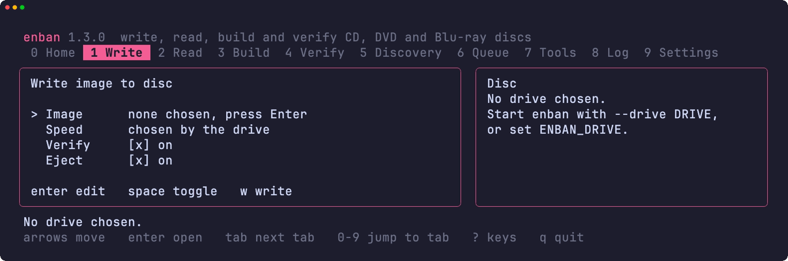<br><sub>The Write tab, with its image, speed, verify and eject fields</sub></td>
<td width="50%" valign="top">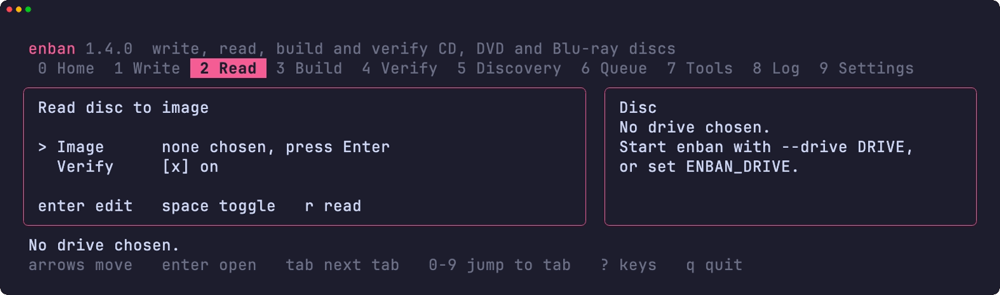<br><sub>The Read tab, with its image and verify fields</sub></td>
</tr>
<tr>
<td width="50%" valign="top">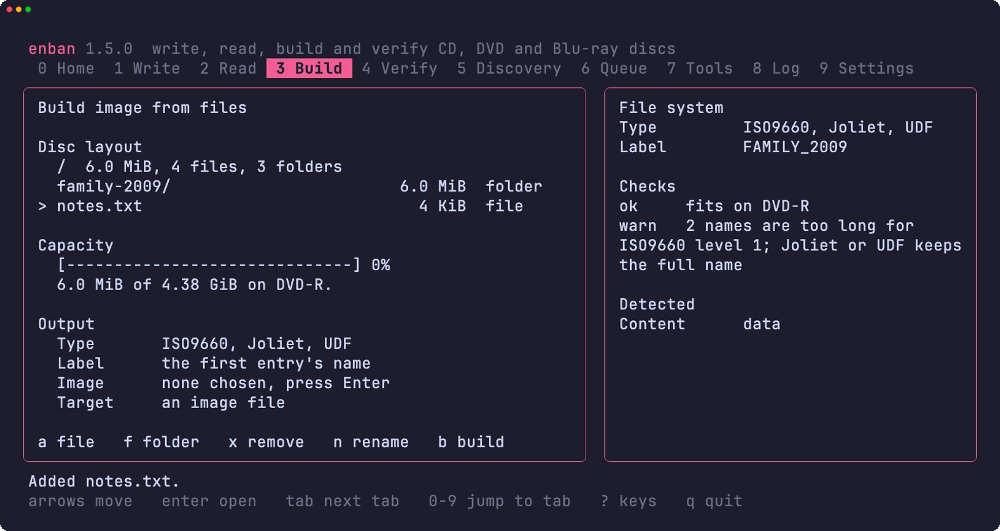<br><sub>The Build tab, with the disc layout, capacity, output fields and the file system checks</sub></td>
<td width="50%" valign="top">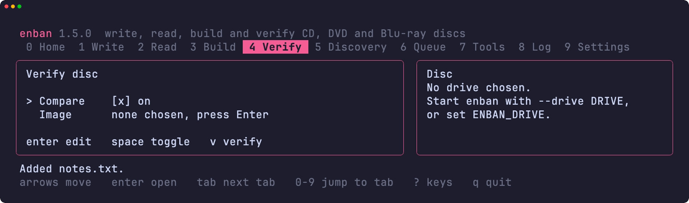<br><sub>The Verify tab, with its compare and image fields</sub></td>
</tr>
<tr>
<td width="50%" valign="top">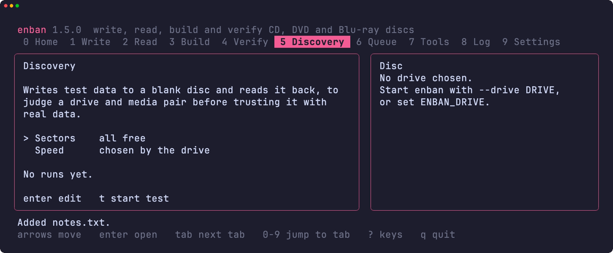<br><sub>The Discovery tab, with its sectors and speed fields</sub></td>
<td width="50%" valign="top"></td>
</tr>
<tr>
<td width="50%" valign="top">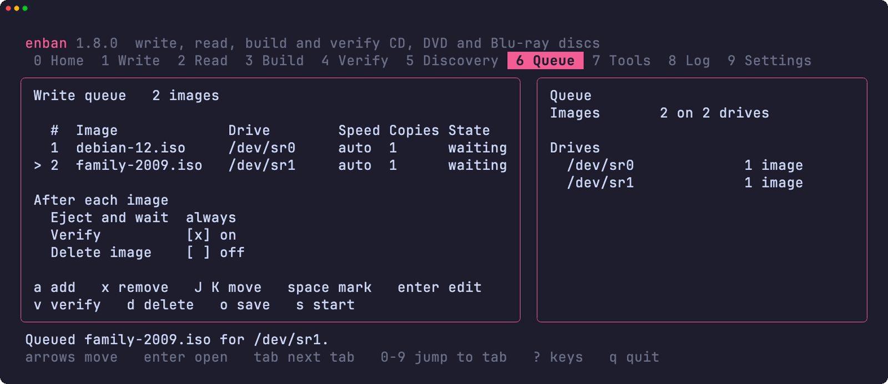<br><sub>The Queue tab, with two images waiting for a drive</sub></td>
<td width="50%" valign="top">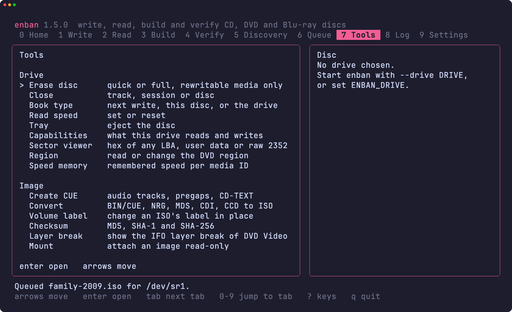<br><sub>The Tools tab, with the drive and image tools</sub></td>
</tr>
<tr>
<td width="50%" valign="top">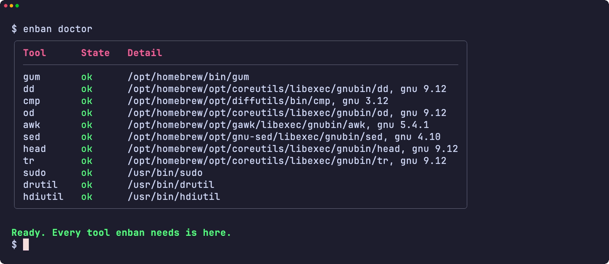<br><sub>doctor checks every tool it needs</sub></td>
<td width="50%" valign="top">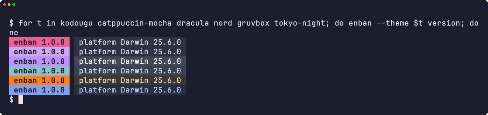<br><sub>The version badge in six themes</sub></td>
</tr>
<tr>
<td width="50%" valign="top">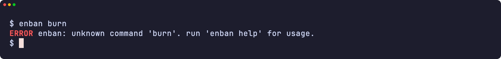<br><sub>An error</sub></td>
<td width="50%" valign="top">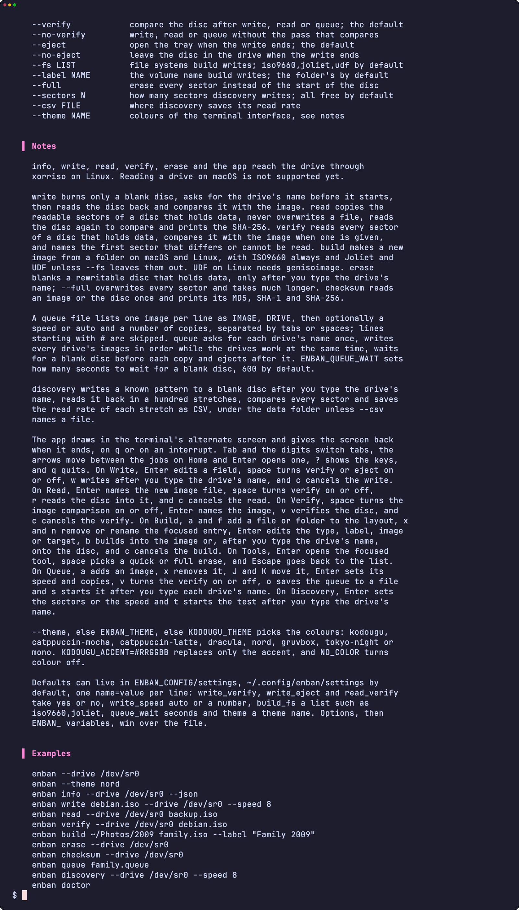<br><sub>The help page</sub></td>
</tr>
</table>

</details>

<a id="development"></a>

## Development

| Command | Description |
|:--------|:------------|
| `make fmt` | Formats every script with shfmt |
| `make lint` | shfmt, ShellCheck on every script, test and completion, and mandoc on the man page |
| `make test` | The `bats` tests under the system `sh` |
| `make test-all` | The same tests under every shell |
| `make test-linux` | The same tests in an Ubuntu container |
| `make coverage` | bashcov line coverage on this Mac and in the Ubuntu container, merged, with the 100% gate CI enforces |

## License

[MIT](LICENSE)
