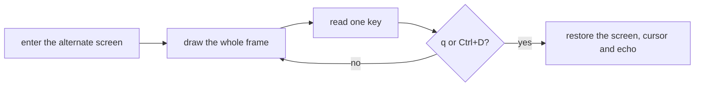

<div align="center">

<h1>enban</h1>

<strong>Write, read, build and verify CD, DVD and Blu-ray discs in a full-screen terminal app.</strong>

English | [日本語](README.ja.md) | [简体中文](README.zh-Hans.md) | [繁體中文 (香港)](README.zh-HK.md)

[](https://github.com/gufranco/enban/actions/workflows/ci.yml)
[](LICENSE)

<p align="center">
  <a href="#quick-start"><strong>Quick start</strong></a> |
  <a href="#how-it-works">How it works</a> |
  <a href="#development">Development</a>
</p>

</div>

`enban`, 円盤, is Japanese for a disc. It does the jobs of a disc burner in a terminal: burn an image, build an image from files, copy a disc to an image, check a disc against an image, and stress-test a drive. It does them in a full-screen app or as plain commands for scripts, on Linux and macOS.

---

<p align="center">
  
</p>

```console
$ enban doctor
gum                ok       /opt/homebrew/bin/gum
dd                 ok       /opt/homebrew/opt/coreutils/libexec/gnubin/dd, gnu 9.12
cmp                ok       /opt/homebrew/opt/diffutils/bin/cmp, gnu 3.12
od                 ok       /opt/homebrew/opt/coreutils/libexec/gnubin/od, gnu 9.12
awk                ok       /opt/homebrew/opt/gawk/libexec/gnubin/awk, gnu 5.4.1
sed                ok       /opt/homebrew/opt/gnu-sed/libexec/gnubin/sed, gnu 4.10
head               ok       /opt/homebrew/opt/coreutils/libexec/gnubin/head, gnu 9.12
tr                 ok       /opt/homebrew/opt/coreutils/libexec/gnubin/tr, gnu 9.12
stat               ok       /opt/homebrew/opt/coreutils/libexec/gnubin/stat, gnu 9.12
sudo               ok       /usr/bin/sudo
hdiutil            ok       /usr/bin/hdiutil
xorriso            ok       /opt/homebrew/bin/xorriso
shasum             ok       /opt/homebrew/bin/shasum
cdrecord           ok       /opt/homebrew/bin/cdrecord
readcd             ok       /opt/homebrew/bin/readcd
mkisofs            ok       /opt/homebrew/bin/mkisofs
cdrdao             ok       /opt/homebrew/bin/cdrdao
dvd+rw-booktype    ok       /opt/homebrew/bin/dvd+rw-booktype
bchunk             ok       /opt/homebrew/bin/bchunk
iat                ok       /opt/homebrew/bin/iat
ffmpeg             ok       /opt/homebrew/bin/ffmpeg
```

<a id="quick-start"></a>

## Quick start

### Prerequisites

| Tool | Why | Install |
|:-----|:----|:--------|
| [`gum`](https://github.com/charmbracelet/gum) | The family look for doctor, version and help | `brew install gum` |
| POSIX `sh`, `stty`, `dd`, `od`, `awk` | The app and its key reading | Preinstalled on macOS and Linux |
| `hdiutil` | Images on macOS | Preinstalled |
| `xorriso` | Image targets, bootable images and the image fields hdiutil cannot write on macOS, and everything on Linux | `brew install xorriso` |
| `cdrecord` and `readcd` from cdrtools, optional on macOS | Real drives and audio CDs on macOS | `brew install cdrtools` |
| `cdrdao`, `dvd+rw-tools`, `bchunk` and `iat`, optional on macOS | Raw CD reads, the book type and image conversion, as on Linux | `brew install cdrdao dvd+rw-tools bchunk iat` |
| `mkisofs`, optional on macOS | DVD Video images, whose files hdiutil writes out of order | `brew install cdrtools` |
| `ffmpeg`, optional | Audio CDs from FLAC, MP3, OGG, M4A and the like | `brew install ffmpeg` or `apt install ffmpeg` |
| `xorriso` and `cdrskin`, optionally `cdrdao`, `genisoimage`, `sg3-utils`, `dvd+rw-tools`, `bchunk`, `iat` and `udisks2` | The drive and images on Linux; genisoimage for UDF images, sg3-utils for close, speed, region and raw sectors, dvd+rw-tools for the book type, bchunk and iat to convert images, udisks2 to mount them | `apt install xorriso cdrskin cdrdao genisoimage sg3-utils dvd+rw-tools bchunk iat udisks2` |

### Install

```bash
git clone https://github.com/gufranco/enban.git
cd enban
make install
```

`make install` copies the tool, its man page and its bash, zsh and fish completions under `~/.local`, and puts `enban` in `~/.local/bin`; set `PREFIX` to change that.

### Verify

`enban doctor` lists every tool and whether it is installed, as in the sample above.

## Usage

| Command | Purpose |
|:--------|:--------|
| `enban --drive /dev/sr0` | Open the full-screen app, with the disc in that drive on the right; `ENBAN_DRIVE` sets the drive too |
| `enban info --drive /dev/sr0` | Describe the drive and the disc in it; `--json` prints one object for scripts |
| `enban write image.iso --drive /dev/sr0` | Burn an image once you type the drive's name, read it back to compare, then eject |
| `enban read --drive /dev/sr0 backup.iso` | Copy a disc into a new image and print its MD5 and SHA-256 |
| `enban verify --drive /dev/sr0 debian.iso` | Compare every sector of the disc with an image, or only check that each one reads |
| `enban build ~/Photos/2009 family.iso` | Make an image from a folder, with ISO9660, Joliet and UDF |
| `enban erase --drive /dev/sr0` | Blank a rewritable disc once you type the drive's name |
| `enban queue family.queue` | Write a list of images, each drive working through its own |
| `enban discovery --drive /dev/sr0` | Fill a blank disc with a pattern, read it back and save the read rate |
| `enban doctor` | List the tools enban needs and whether they are installed |

enban also converts and relabels images, writes CUE sheets and audio CDs, closes sessions, shows sectors and layer breaks, and reads a drive's region, book type and features. `man enban` describes every command, option and key, and `enban help` prints the same summary.

On macOS a real drive is named like `IODVDServices/0` or `IOCompactDiscServices/0` and reached through `cdrecord` and `readcd` from cdrtools, and an image file stands in for a drive anywhere as `--drive stdio:disc.iso`. Closing a session, the `tray`, `speed`, `region` and `booktype` commands and raw sectors still need Linux.

### The app

| Key | Does |
|:----|:-----|
| Arrows, Enter | Move between jobs and fields, open a tab or edit a field |
| Space | Turn the focused switch on or off |
| Tab, `0` to `9` | Go to the next tab, or straight to one |
| `c` | Cancel the running job, after you answer `y` |
| `?` | Show the keys; each tab also names its own keys on its last line |
| `q` or Ctrl+D | Quit and give the terminal back; refused while a job runs |

### Settings and themes

The Settings tab sorts its defaults into Write, Read, Build, Queue, Events and Look pages and keeps them in `~/.config/enban/settings`, one `name=value` per line. An option, then an `ENBAN_` variable, wins over the file. `--theme`, `ENBAN_THEME` and `KODOUGU_THEME` pick the colours, and `NO_COLOR` turns colour off. enban follows the command-line contract of its family, described in [FAMILY.md](FAMILY.md).

<a id="how-it-works"></a>

## How it works

gum draws one widget per process and has no event loop, so enban runs its own loop and keeps gum for the moments a field is edited.



- The frame is drawn with escape sequences in the theme's colours. A full frame at 140 columns, with both panes, took 77 ms on the owner's Mac while other test suites ran, against a budget of 250 ms; drawing each box through gum took 524 ms in the mockups.
- Below 100 columns the jobs and the disc pane stack, and the six jobs become one list.
- Keys are read one byte at a time with `dd` and decoded from hex, so arrows, Escape, Enter and Ctrl+D are told apart.
- The terminal is restored on `q`, on Ctrl+D and on an interrupt. GNU `stty` on macOS reports a false failure when echo is turned back on, so enban checks `stty -a` itself and warns only when typing is really still hidden.
- Without a terminal the app never opens; enban names the problem and exits 1.

<a id="portability"></a>

## Portability

Everything is POSIX `sh` with ShellCheck `-o all` at zero findings. The suites drive the app through a pseudo-terminal with `script`, under every shell and toolset in [FAMILY.md](FAMILY.md).

<a id="screens"></a>

## Screens

<details>
<summary>Every screen, recorded from a real run with <code>make screens</code></summary>
<br>

<table>
<tr>
<td width="50%" valign="top"><br><sub>Home, with the six jobs and the disc pane</sub></td>
<td width="50%" valign="top"><br><sub>The key list that ? opens</sub></td>
</tr>
<tr>
<td width="50%" valign="top"><br><sub>The Write tab, with its image, speed, copies and switches</sub></td>
<td width="50%" valign="top"><br><sub>The Read tab, with its image and verify fields</sub></td>
</tr>
<tr>
<td width="50%" valign="top"><br><sub>The Build tab, with the disc layout, capacity, output fields and the file system checks</sub></td>
<td width="50%" valign="top"><br><sub>The Verify tab, with its compare and image fields</sub></td>
</tr>
<tr>
<td width="50%" valign="top"><br><sub>The Discovery tab, with its sectors and speed fields</sub></td>
<td width="50%" valign="top"><br><sub>The Log tab, with this session's entries</sub></td>
</tr>
<tr>
<td width="50%" valign="top"><br><sub>The Write page of the Settings tab</sub></td>
<td width="50%" valign="top"></td>
</tr>
<tr>
<td width="50%" valign="top"><br><sub>The Queue tab, with two images waiting for a drive</sub></td>
<td width="50%" valign="top"><br><sub>The Tools tab, with the drive and image tools</sub></td>
</tr>
<tr>
<td width="50%" valign="top"><br><sub>doctor checks every tool it needs</sub></td>
<td width="50%" valign="top"><br><sub>The version badge in six themes</sub></td>
</tr>
<tr>
<td width="50%" valign="top"><br><sub>An error</sub></td>
<td width="50%" valign="top"><br><sub>The help page</sub></td>
</tr>
</table>

</details>

<a id="development"></a>

## Development

| Command | Description |
|:--------|:------------|
| `make fmt` | Formats every script with shfmt |
| `make lint` | shfmt, ShellCheck on every script, test and completion, mandoc on the man page, and yamllint and actionlint on the workflows |
| `make test` | The `bats` tests under the system `sh` |
| `make test-all` | The same tests under every shell |
| `make test-linux` | The same tests in an Ubuntu container |
| `make coverage` | bashcov line coverage on this Mac and in the Ubuntu container, merged, with the 100% gate CI enforces |
| `make screens` | The README screens, recorded from the real tool with VHS, on macOS |

## License

[MIT](LICENSE)
