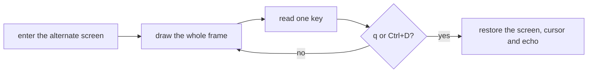

<div align="center">

<h1>enban</h1>

<strong>Write, read, build and verify CD, DVD and Blu-ray discs in a full-screen terminal app.</strong>

[](https://github.com/gufranco/enban/actions/workflows/ci.yml)
[](LICENSE)

<p align="center">
  <a href="#quick-start"><strong>Quick start</strong></a> |
  <a href="#how-it-works">How it works</a> |
  <a href="#development">Development</a>
</p>

</div>

`enban`, 円盤, is Japanese for a disc. It aims at the jobs a disc burner does: write an image, write files, read a disc to an image, build an image, verify a disc against an image, and stress-test a drive. Today it ships the app itself: the full-screen frame, its tabs and its keys. The jobs arrive in the coming releases, each as a tab and as a plain command for scripts.

---

<p align="center">
  
</p>

```console
$ enban doctor
gum                ok       /opt/homebrew/bin/gum
dd                 ok       /opt/homebrew/opt/coreutils/libexec/gnubin/dd, gnu 9.12
cmp                ok       /opt/homebrew/opt/diffutils/bin/cmp, gnu 3.12
od                 ok       /opt/homebrew/opt/coreutils/libexec/gnubin/od, gnu 9.12
awk                ok       /opt/homebrew/opt/gawk/libexec/gnubin/awk, gnu 5.4.1
sed                ok       /opt/homebrew/opt/gnu-sed/libexec/gnubin/sed, gnu 4.10
head               ok       /opt/homebrew/opt/coreutils/libexec/gnubin/head, gnu 9.12
tr                 ok       /opt/homebrew/opt/coreutils/libexec/gnubin/tr, gnu 9.12
sudo               ok       /usr/bin/sudo
drutil             ok       /usr/bin/drutil
hdiutil            ok       /usr/bin/hdiutil
```

<a id="quick-start"></a>

## Quick start

### Prerequisites

| Tool | Why | Install |
|:-----|:----|:--------|
| [`gum`](https://github.com/charmbracelet/gum) | The family look for doctor, version and help | `brew install gum` |
| POSIX `sh`, `stty`, `dd`, `od`, `awk` | The app and its key reading | Preinstalled on macOS and Linux |
| `drutil` and `hdiutil` | The drive and images on macOS | Preinstalled |
| `xorriso` and `cdrskin`, optionally `cdrdao` | The drive and images on Linux | `apt install xorriso cdrskin cdrdao` |

### Install

```bash
git clone https://github.com/gufranco/enban.git
cd enban
make install
```

`make install` copies the tool, its man page and its bash, zsh and fish completions under `~/.local`, and puts `enban` in `~/.local/bin`; set `PREFIX` to change that.

### Verify

`enban doctor` lists every tool and whether it is installed, as in the sample above.

## Usage

| Command | Purpose |
|:--------|:--------|
| `enban` | Open the full-screen app on a terminal |
| `enban doctor` | List the tools enban needs and whether they are installed |
| `enban version`, `enban help` | Print the version or the full usage page |

| Key | In the app |
|:----|:-----------|
| `0` to `9` | Switch to that tab |
| Left and right arrows | Previous or next tab |
| `q` or Ctrl+D | Quit and give the terminal back |

`--theme <name>` picks the colours; `ENBAN_THEME`, then `KODOUGU_THEME`, set the same, and `NO_COLOR` turns colour off. enban follows the shared command-line contract of its family, described in [FAMILY.md](FAMILY.md).

<a id="how-it-works"></a>

## How it works

gum draws one widget per process and has no event loop, so enban runs its own loop and keeps gum for the moments a field is edited.



- The frame is drawn with escape sequences in the theme's colours. A frame takes about 24 ms on the owner's Mac, against a budget of 250 ms; drawing each box through gum took 524 ms in the mockups.
- Keys are read one byte at a time with `dd` and decoded from hex, so arrows, Escape, Enter and Ctrl+D are told apart.
- The terminal is restored on `q`, on Ctrl+D and on an interrupt. GNU `stty` on macOS reports a false failure when echo is turned back on, so enban checks `stty -a` itself and warns only when typing is really still hidden.
- Without a terminal the app never opens; enban names the problem and exits 1.

<a id="portability"></a>

## Portability

Everything is POSIX `sh` with ShellCheck `-o all` at zero findings. The suites drive the app through a pseudo-terminal with `script`, under every shell and toolset in [FAMILY.md](FAMILY.md).

<a id="screens"></a>

## Screens

<details>
<summary>Every screen, recorded from a real run with <code>make screens</code></summary>
<br>

<table>
<tr>
<td width="50%" valign="top"><br><sub>The home tab</sub></td>
<td width="50%" valign="top"><br><sub>The keys tab</sub></td>
</tr>
<tr>
<td width="50%" valign="top"><br><sub>doctor checks every tool it needs</sub></td>
<td width="50%" valign="top"><br><sub>The version badge in six themes</sub></td>
</tr>
<tr>
<td width="50%" valign="top"><br><sub>An error</sub></td>
<td width="50%" valign="top"><br><sub>The help page</sub></td>
</tr>
</table>

</details>

<a id="development"></a>

## Development

| Command | Description |
|:--------|:------------|
| `make fmt` | Formats every script with shfmt |
| `make lint` | shfmt, ShellCheck on every script, test and completion, and mandoc on the man page |
| `make test` | The `bats` tests under the system `sh` |
| `make test-all` | The same tests under every shell |
| `make test-linux` | The same tests in an Ubuntu container |
| `make coverage` | bashcov line coverage on this Mac and in the Ubuntu container, merged, with the 100% gate CI enforces |

## License

[MIT](LICENSE)
