<div align="center">

<h1>enban</h1>

<strong>在終端機的全螢幕應用程式中燒錄、讀取、製作和驗證 CD、DVD 與 Blu-ray 光碟。</strong>

[English](README.md) | [日本語](README.ja.md) | [简体中文](README.zh-Hans.md) | 繁體中文 (香港)

[](https://github.com/gufranco/enban/actions/workflows/ci.yml)
[](LICENSE)

<p align="center">
  <a href="#quick-start"><strong>快速開始</strong></a> |
  <a href="#how-it-works">運作原理</a> |
  <a href="#development">開發</a>
</p>

</div>

`enban`，円盤，是日文中光碟的意思。它在終端機中完成燒錄軟件的工作：燒錄映像檔、以檔案製作映像檔、把光碟複製成映像檔、對照映像檔檢查光碟，以及對光碟機進行壓力測試。這些工作可以在全螢幕應用程式中進行，也可以用供指令碼使用的一般指令完成，支援 Linux 和 macOS。

---

<p align="center">
  
</p>

```console
$ enban doctor
gum                ok       /opt/homebrew/bin/gum
dd                 ok       /opt/homebrew/opt/coreutils/libexec/gnubin/dd, gnu 9.12
cmp                ok       /opt/homebrew/opt/diffutils/bin/cmp, gnu 3.12
od                 ok       /opt/homebrew/opt/coreutils/libexec/gnubin/od, gnu 9.12
awk                ok       /opt/homebrew/opt/gawk/libexec/gnubin/awk, gnu 5.4.1
sed                ok       /opt/homebrew/opt/gnu-sed/libexec/gnubin/sed, gnu 4.10
head               ok       /opt/homebrew/opt/coreutils/libexec/gnubin/head, gnu 9.12
tr                 ok       /opt/homebrew/opt/coreutils/libexec/gnubin/tr, gnu 9.12
stat               ok       /opt/homebrew/opt/coreutils/libexec/gnubin/stat, gnu 9.12
sudo               ok       /usr/bin/sudo
hdiutil            ok       /usr/bin/hdiutil
xorriso            ok       /opt/homebrew/bin/xorriso
shasum             ok       /opt/homebrew/bin/shasum
cdrecord           ok       /opt/homebrew/bin/cdrecord
readcd             ok       /opt/homebrew/bin/readcd
mkisofs            ok       /opt/homebrew/bin/mkisofs
cdrdao             ok       /opt/homebrew/bin/cdrdao
dvd+rw-booktype    ok       /opt/homebrew/bin/dvd+rw-booktype
bchunk             ok       /opt/homebrew/bin/bchunk
iat                ok       /opt/homebrew/bin/iat
ffmpeg             ok       /opt/homebrew/bin/ffmpeg
```

<a id="quick-start"></a>

## 快速開始

### 先決條件

| 工具 | 用途 | 安裝 |
|:-----|:----|:--------|
| [`gum`](https://github.com/charmbracelet/gum) | doctor、version 和 help 的家族統一外觀 | `brew install gum` |
| POSIX `sh`、`stty`、`dd`、`od`、`awk` | 應用程式本身和按鍵讀取 | macOS 和 Linux 內置 |
| `hdiutil` | 在 macOS 上掛載映像檔 | 內置 |
| `xorriso` | 映像檔、代替光碟機的映像檔，以及 Linux 上的光碟機 | `brew install xorriso` |
| cdrtools 的 `cdrecord`、`readcd` 和 `mkisofs`，用於 macOS | macOS 上的實體光碟機、音樂 CD 以及 UDF 和 DVD Video 映像檔 | `brew install cdrtools` |
| `cdrdao`、`dvd+rw-tools`、`bchunk` 和 `iat`，macOS 上可選 | 與 Linux 一樣，用於 CD 原始讀取、書本類型和映像檔轉換 | `brew install cdrdao dvd+rw-tools bchunk iat` |
| `ffmpeg`，可選 | 以 FLAC、MP3、OGG、M4A 等製作音樂 CD | `brew install ffmpeg` 或 `apt install ffmpeg` |
| `xorriso` 和 `cdrskin`，可選 `cdrdao`、`genisoimage`、`sg3-utils`、`dvd+rw-tools`、`bchunk`、`iat` 和 `udisks2` | Linux 上的光碟機和映像檔；genisoimage 用於 UDF 映像檔，sg3-utils 用於封碟、速度、區碼和原始磁區，dvd+rw-tools 用於書本類型，bchunk 和 iat 用於轉換映像檔，udisks2 用於掛載 | `apt install xorriso cdrskin cdrdao genisoimage sg3-utils dvd+rw-tools bchunk iat udisks2` |

### 安裝

```bash
git clone https://github.com/gufranco/enban.git
cd enban
make install
```

`make install` 會把工具、man 手冊以及 bash、zsh 和 fish 補全複製到 `~/.local` 下，並把 `enban` 放到 `~/.local/bin`；以 `PREFIX` 可以更改位置。

### 驗證

`enban doctor` 會像上面的示例一樣，列出每個工具以及它是否已安裝。

## 用法

| 指令 | 用途 |
|:--------|:--------|
| `enban --drive /dev/sr0` | 開啟全螢幕應用程式，右側顯示該光碟機內的光碟；亦可用 `ENBAN_DRIVE` 指定光碟機 |
| `enban info --drive /dev/sr0` | 描述光碟機和其中的光碟；`--json` 為指令碼輸出一個物件 |
| `enban write image.iso --drive /dev/sr0` | 輸入光碟機名稱後燒錄映像檔，讀回比對，然後退出光碟 |
| `enban read --drive /dev/sr0 backup.iso` | 把光碟複製成新映像檔，並顯示其 MD5 和 SHA-256 |
| `enban verify --drive /dev/sr0 debian.iso` | 把光碟的每個磁區與映像檔比對，或只檢查每個磁區能否讀取 |
| `enban build ~/Photos/2009 family.iso` | 以資料夾製作帶 ISO9660、Joliet 和 UDF 的映像檔 |
| `enban erase --drive /dev/sr0` | 輸入光碟機名稱後抹除可重寫光碟 |
| `enban queue family.queue` | 燒錄一組映像檔，每部光碟機依次處理分給自己的映像檔 |
| `enban discovery --drive /dev/sr0` | 以固定圖案寫滿空白光碟，讀回並儲存讀取速度 |
| `enban doctor` | 列出 enban 需要的工具以及它們是否已安裝 |

enban 亦能轉換映像檔並修改卷標、寫 CUE 表和音樂 CD、封閉工作階段、顯示磁區和層切換點，以及讀取光碟機的區碼、書本類型和功能。`man enban` 說明每個指令、選項和按鍵，`enban help` 顯示同樣的概要。

在 macOS 上，實體光碟機寫成 `IODVDServices/0` 或 `IOCompactDiscServices/0` 這樣的名稱，經 cdrtools 的 `cdrecord` 和 `readcd` 存取；在任何系統上都可以用 `--drive stdio:disc.iso` 讓映像檔代替光碟機。只有 `region` 和 `close --track` 仍然需要 Linux，因為 macOS 上沒有能執行它們的指令。

### 應用程式

| 按鍵 | 作用 |
|:----|:-----|
| 方向鍵、Enter | 在工作和欄位之間移動，開啟分頁或編輯欄位 |
| 空白鍵 | 開啟或關閉目前選取的開關 |
| Tab、`0` 至 `9` | 切換到下一個分頁，或直接跳到某個分頁 |
| `c` | 回答 `y` 後取消正在執行的工作 |
| `?` | 顯示按鍵；每個分頁的最後一行亦列出它自己的按鍵 |
| `q` 或 Ctrl+D | 離開並交還終端機；工作執行時不會離開 |

### 設定與主題

Settings 分頁把預設值分成 Write、Read、Build、Queue、Events 和 Look 數頁，儲存在 `~/.config/enban/settings`，每行一個 `name=value`。選項優先，其次是 `ENBAN_` 變數，兩者都優先於檔案。`--theme`、`ENBAN_THEME` 和 `KODOUGU_THEME` 選擇配色，`NO_COLOR` 關閉顏色。enban 遵循其家族共同的指令列約定，詳見 [FAMILY.md](FAMILY.md)。

<a id="how-it-works"></a>

## 運作原理

gum 每個程序只繪製一個元件，亦沒有事件迴圈，所以 enban 自行執行迴圈，只在編輯欄位時使用 gum。

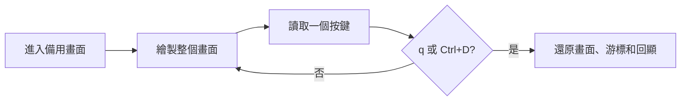

- 畫面以主題顏色的跳脫序列繪製。在作者的 Mac 上、其他測試同時執行時，140 欄、含兩個窗格的完整畫面用時 77 ms，預算為 250 ms；在原型中以 gum 繪製每個方框用時 524 ms。
- 少於 100 欄時，工作和光碟窗格上下堆疊，六項工作變成一個清單。
- 按鍵以 `dd` 每次讀取一個位元組，再從十六進制解碼，因此能區分方向鍵、Escape、Enter 和 Ctrl+D。
- 按 `q`、Ctrl+D 或中斷時都會還原終端機。macOS 上的 GNU `stty` 在還原回顯時會誤報失敗，所以 enban 自行檢查 `stty -a`，只在輸入確實仍被隱藏時才警告。
- 沒有終端機時應用程式不會開啟；enban 說明問題並以 1 離開。

<a id="portability"></a>

## 可移植性

全部以 POSIX `sh` 編寫，ShellCheck `-o all` 零警告。測試經 `script` 的偽終端機操作應用程式，在 [FAMILY.md](FAMILY.md) 列出的每種 shell 和工具集下執行。

<a id="screens"></a>

## 畫面

<details>
<summary>以 <code>make screens</code> 從真實執行錄製的所有畫面</summary>
<br>

<table>
<tr>
<td width="50%" valign="top">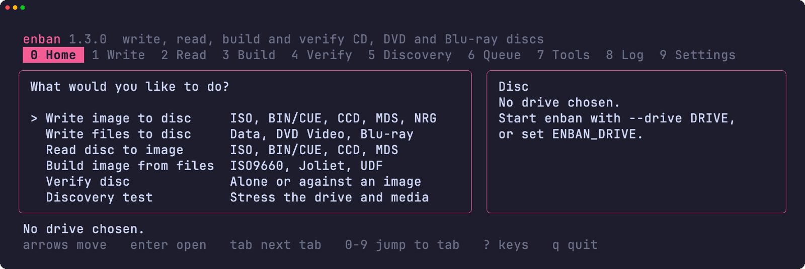<br><sub>Home，六項工作和光碟窗格</sub></td>
<td width="50%" valign="top">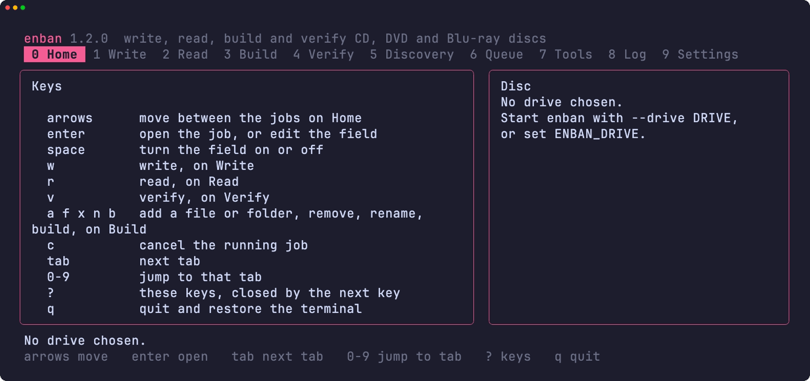<br><sub>按 ? 開啟的按鍵清單</sub></td>
</tr>
<tr>
<td width="50%" valign="top">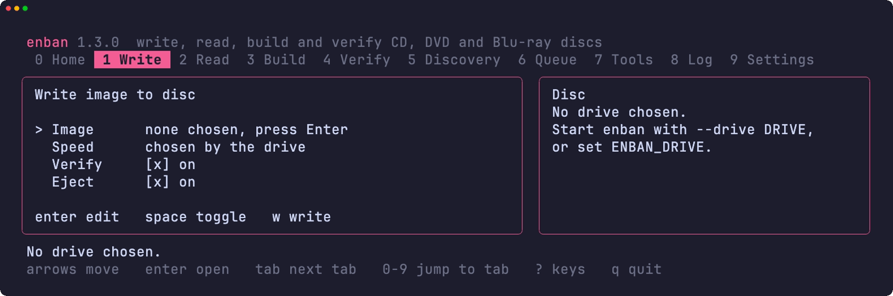<br><sub>Write 分頁，含映像檔、速度、份數和開關</sub></td>
<td width="50%" valign="top">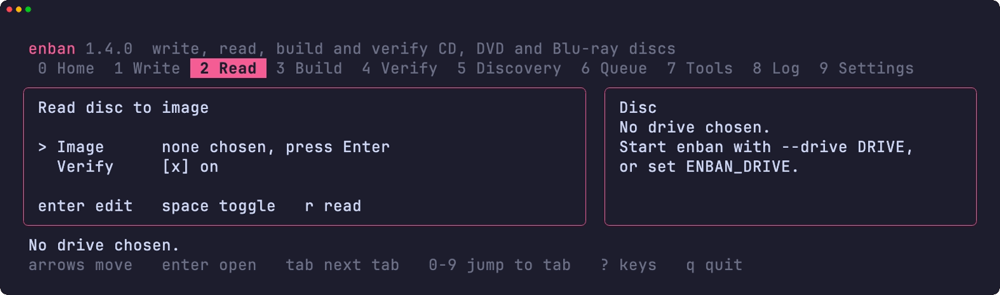<br><sub>Read 分頁，含映像檔和驗證欄位</sub></td>
</tr>
<tr>
<td width="50%" valign="top">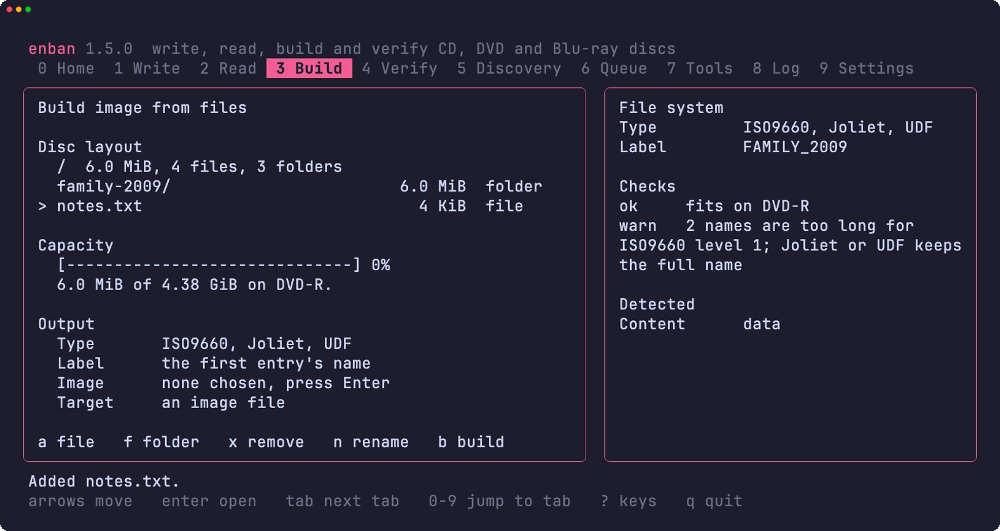<br><sub>Build 分頁，含光碟佈局、容量、輸出欄位和檔案系統檢查</sub></td>
<td width="50%" valign="top">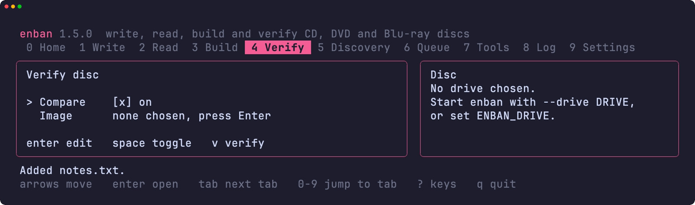<br><sub>Verify 分頁，含比對和映像檔欄位</sub></td>
</tr>
<tr>
<td width="50%" valign="top">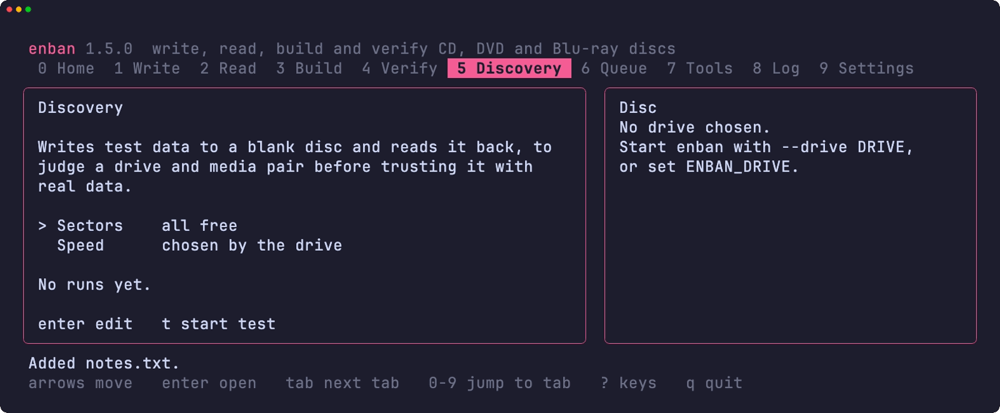<br><sub>Discovery 分頁，含磁區和速度欄位</sub></td>
<td width="50%" valign="top">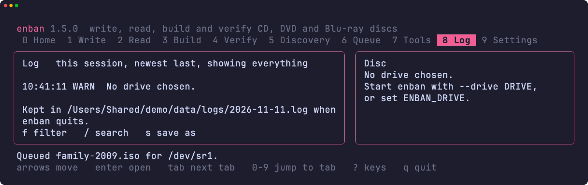<br><sub>Log 分頁，含本次工作階段的記錄</sub></td>
</tr>
<tr>
<td width="50%" valign="top">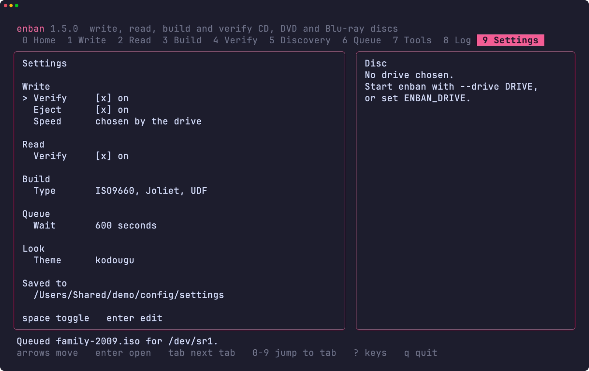<br><sub>Settings 分頁的 Write 頁</sub></td>
<td width="50%" valign="top"></td>
</tr>
<tr>
<td width="50%" valign="top">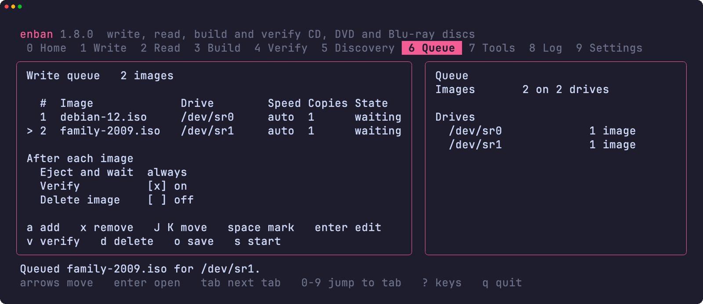<br><sub>Queue 分頁，兩個映像檔在等待光碟機</sub></td>
<td width="50%" valign="top">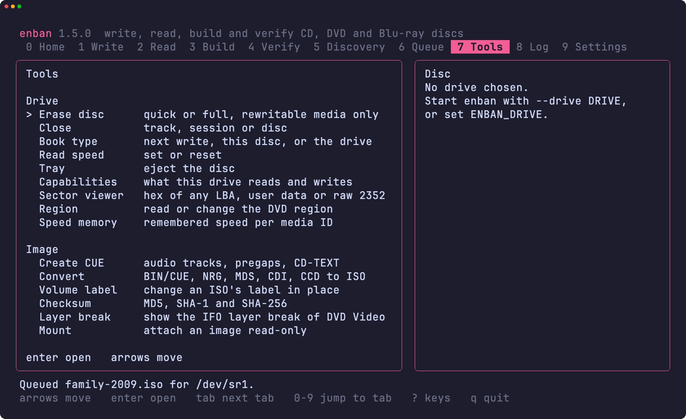<br><sub>Tools 分頁，含光碟機和映像檔工具</sub></td>
</tr>
<tr>
<td width="50%" valign="top">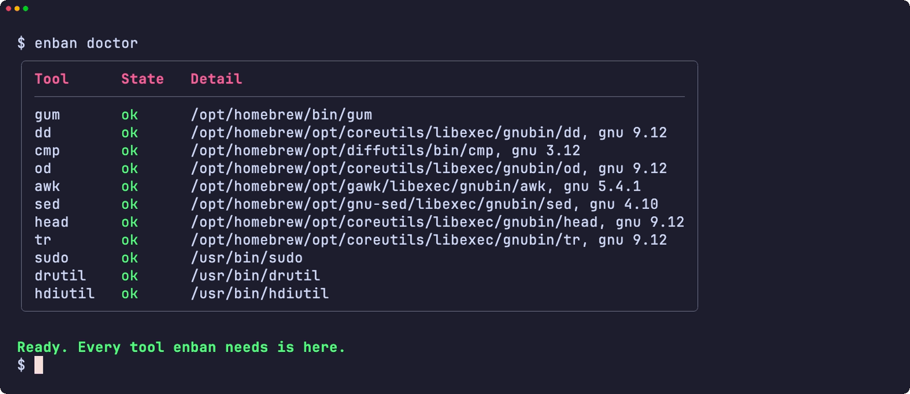<br><sub>doctor 檢查所需的每個工具</sub></td>
<td width="50%" valign="top">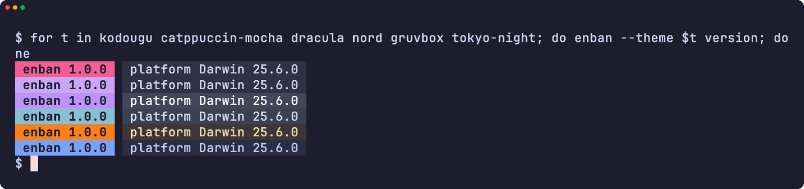<br><sub>六種主題下的版本標記</sub></td>
</tr>
<tr>
<td width="50%" valign="top">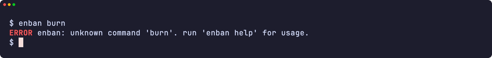<br><sub>錯誤</sub></td>
<td width="50%" valign="top">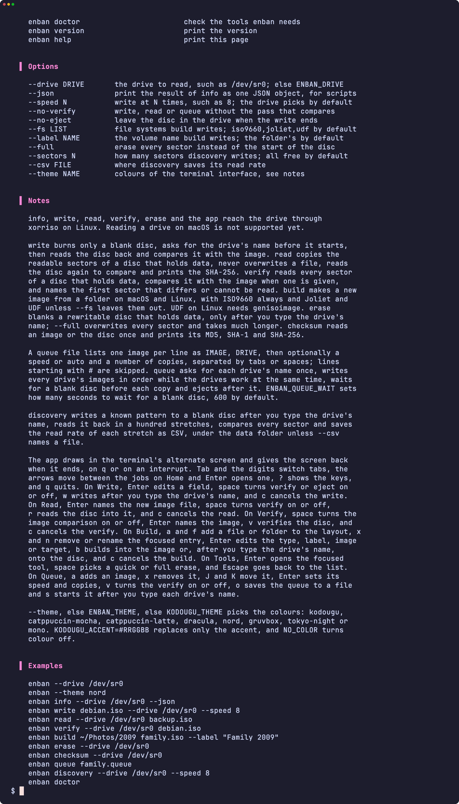<br><sub>說明頁面</sub></td>
</tr>
</table>

</details>

<a id="development"></a>

## 開發

| 指令 | 說明 |
|:--------|:------------|
| `make fmt` | 以 shfmt 格式化所有指令碼 |
| `make lint` | shfmt、對所有指令碼、測試和補全執行 ShellCheck，以 mandoc 檢查 man 手冊，以 yamllint 和 actionlint 檢查工作流程 |
| `make test` | 在系統 `sh` 下執行 `bats` 測試 |
| `make test-all` | 在每種 shell 下執行同樣的測試 |
| `make test-linux` | 在 Ubuntu 容器中執行同樣的測試 |
| `make coverage` | 合併這部 Mac 和 Ubuntu 容器中的 bashcov 行覆蓋率，並執行 CI 同樣的 100% 門檻 |
| `make screens` | 在 macOS 上以 VHS 從真實工具錄製 README 畫面 |

## 授權

[MIT](LICENSE)
