<div align="center">

<h1>enban</h1>

<strong>在终端的全屏应用中刻录、读取、制作和校验 CD、DVD 与 Blu-ray 光盘。</strong>

[English](README.md) | [日本語](README.ja.md) | 简体中文 | [繁體中文 (香港)](README.zh-HK.md)

[](https://github.com/gufranco/enban/actions/workflows/ci.yml)
[](LICENSE)

<p align="center">
  <a href="#quick-start"><strong>快速开始</strong></a> |
  <a href="#how-it-works">工作原理</a> |
  <a href="#development">开发</a>
</p>

</div>

`enban`，円盤，是日语里光盘的意思。它在终端里完成刻录软件的工作：刻录镜像、用文件制作镜像、把光盘复制成镜像、对照镜像检查光盘，以及对光驱做压力测试。这些工作可以在全屏应用里做，也可以用供脚本使用的普通命令做，支持 Linux 和 macOS。

---

<p align="center">
  
</p>

```console
$ enban doctor
gum                ok       /opt/homebrew/bin/gum
dd                 ok       /opt/homebrew/opt/coreutils/libexec/gnubin/dd, gnu 9.12
cmp                ok       /opt/homebrew/opt/diffutils/bin/cmp, gnu 3.12
od                 ok       /opt/homebrew/opt/coreutils/libexec/gnubin/od, gnu 9.12
awk                ok       /opt/homebrew/opt/gawk/libexec/gnubin/awk, gnu 5.4.1
sed                ok       /opt/homebrew/opt/gnu-sed/libexec/gnubin/sed, gnu 4.10
head               ok       /opt/homebrew/opt/coreutils/libexec/gnubin/head, gnu 9.12
tr                 ok       /opt/homebrew/opt/coreutils/libexec/gnubin/tr, gnu 9.12
stat               ok       /opt/homebrew/opt/coreutils/libexec/gnubin/stat, gnu 9.12
sudo               ok       /usr/bin/sudo
hdiutil            ok       /usr/bin/hdiutil
xorriso            ok       /opt/homebrew/bin/xorriso
shasum             ok       /opt/homebrew/bin/shasum
cdrecord           ok       /opt/homebrew/bin/cdrecord
readcd             ok       /opt/homebrew/bin/readcd
mkisofs            ok       /opt/homebrew/bin/mkisofs
cdrdao             ok       /opt/homebrew/bin/cdrdao
dvd+rw-booktype    ok       /opt/homebrew/bin/dvd+rw-booktype
bchunk             ok       /opt/homebrew/bin/bchunk
iat                ok       /opt/homebrew/bin/iat
ffmpeg             ok       /opt/homebrew/bin/ffmpeg
```

<a id="quick-start"></a>

## 快速开始

### 前提条件

| 工具 | 用途 | 安装 |
|:-----|:----|:--------|
| [`gum`](https://github.com/charmbracelet/gum) | doctor、version 和 help 的家族统一外观 | `brew install gum` |
| POSIX `sh`、`stty`、`dd`、`od`、`awk` | 应用本身和按键读取 | macOS 和 Linux 自带 |
| `hdiutil` | 在 macOS 上挂载镜像 | 自带 |
| `xorriso` | 镜像、代替光驱的镜像，以及 Linux 上的光驱 | `brew install xorriso` |
| cdrtools 的 `cdrecord`、`readcd` 和 `mkisofs`，用于 macOS | macOS 上的实体光驱、音乐 CD 以及 UDF 和 DVD Video 镜像 | `brew install cdrtools` |
| `cdrdao`、`dvd+rw-tools`、`bchunk` 和 `iat`，macOS 上可选 | 与 Linux 一样，用于 CD 原始读取、书本类型和镜像转换 | `brew install cdrdao dvd+rw-tools bchunk iat` |
| `ffmpeg`，可选 | 用 FLAC、MP3、OGG、M4A 等制作音乐 CD | `brew install ffmpeg` 或 `apt install ffmpeg` |
| `xorriso` 和 `cdrskin`，可选 `cdrdao`、`genisoimage`、`sg3-utils`、`dvd+rw-tools`、`bchunk`、`iat` 和 `udisks2` | Linux 上的光驱和镜像；genisoimage 用于 UDF 镜像，sg3-utils 用于封盘、速度、区码和原始扇区，dvd+rw-tools 用于书本类型，bchunk 和 iat 用于转换镜像，udisks2 用于挂载 | `apt install xorriso cdrskin cdrdao genisoimage sg3-utils dvd+rw-tools bchunk iat udisks2` |

### 安装

```bash
git clone https://github.com/gufranco/enban.git
cd enban
make install
```

`make install` 会把工具、man 手册以及 bash、zsh 和 fish 补全复制到 `~/.local` 下，并把 `enban` 放到 `~/.local/bin`；用 `PREFIX` 可以改变位置。

### 验证

`enban doctor` 会像上面的示例一样，列出每个工具以及它是否已安装。

## 用法

| 命令 | 用途 |
|:--------|:--------|
| `enban --drive /dev/sr0` | 打开全屏应用，右侧显示该光驱里的光盘；也可以用 `ENBAN_DRIVE` 指定光驱 |
| `enban info --drive /dev/sr0` | 描述光驱和其中的光盘；`--json` 为脚本输出一个对象 |
| `enban write image.iso --drive /dev/sr0` | 输入光驱名称后刻录镜像，读回比对，然后弹出 |
| `enban read --drive /dev/sr0 backup.iso` | 把光盘复制成新镜像，并显示其 MD5 和 SHA-256 |
| `enban verify --drive /dev/sr0 debian.iso` | 把光盘的每个扇区与镜像比对，或只检查每个扇区能否读取 |
| `enban build ~/Photos/2009 family.iso` | 用文件夹制作带 ISO9660、Joliet 和 UDF 的镜像 |
| `enban erase --drive /dev/sr0` | 输入光驱名称后擦除可重写光盘 |
| `enban queue family.queue` | 刻录一组镜像，每个光驱依次处理分给自己的镜像 |
| `enban discovery --drive /dev/sr0` | 用固定图案写满空白光盘，读回并保存读取速度 |
| `enban doctor` | 列出 enban 需要的工具以及它们是否已安装 |

enban 还能转换镜像并修改卷标、写 CUE 表和音乐 CD、封闭会话、显示扇区和层切换点，以及读取光驱的区码、书本类型和功能。`man enban` 说明每个命令、选项和按键，`enban help` 显示同样的概要。

在 macOS 上，实体光驱写成 `IODVDServices/0` 或 `IOCompactDiscServices/0` 这样的名称，通过 cdrtools 的 `cdrecord` 和 `readcd` 访问；在任何系统上都可以用 `--drive stdio:disc.iso` 让镜像文件代替光驱。只有 `region` 和 `close --track` 仍然需要 Linux，因为 macOS 上没有能执行它们的命令。

### 应用

| 按键 | 作用 |
|:----|:-----|
| 方向键、Enter | 在任务和字段之间移动，打开标签页或编辑字段 |
| 空格 | 打开或关闭当前选中的开关 |
| Tab、`0` 到 `9` | 切换到下一个标签页，或直接跳到某个标签页 |
| `c` | 回答 `y` 后取消正在运行的任务 |
| `?` | 显示按键；每个标签页的最后一行也列出它自己的按键 |
| `q` 或 Ctrl+D | 退出并交还终端；任务运行时不会退出 |

### 设置与主题

Settings 标签页把默认值分成 Write、Read、Build、Queue、Events 和 Look 几页，保存在 `~/.config/enban/settings`，每行一个 `name=value`。选项优先，其次是 `ENBAN_` 变量，二者都优先于文件。`--theme`、`ENBAN_THEME` 和 `KODOUGU_THEME` 选择配色，`NO_COLOR` 关闭颜色。enban 遵循其家族共同的命令行约定，详见 [FAMILY.md](FAMILY.md)。

<a id="how-it-works"></a>

## 工作原理

gum 每个进程只绘制一个组件，也没有事件循环，所以 enban 自己运行循环，只在编辑字段时使用 gum。

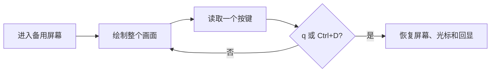

- 画面用主题颜色的转义序列绘制。在作者的 Mac 上、其他测试同时运行时，140 列、含两个窗格的完整画面用时 77 ms，预算为 250 ms；在原型中用 gum 绘制每个方框用时 524 ms。
- 少于 100 列时，任务和光盘窗格上下堆叠，六个任务变成一个列表。
- 按键用 `dd` 每次读取一个字节，再从十六进制解码，因此能区分方向键、Escape、Enter 和 Ctrl+D。
- 按 `q`、Ctrl+D 或中断时都会恢复终端。macOS 上的 GNU `stty` 在恢复回显时会误报失败，所以 enban 自己检查 `stty -a`，只在输入确实仍被隐藏时才警告。
- 没有终端时应用不会打开；enban 说明问题并以 1 退出。

<a id="portability"></a>

## 可移植性

全部用 POSIX `sh` 编写，ShellCheck `-o all` 零告警。测试通过 `script` 的伪终端操作应用，在 [FAMILY.md](FAMILY.md) 列出的每种 shell 和工具集下运行。

<a id="screens"></a>

## 界面

<details>
<summary>用 <code>make screens</code> 从真实运行录制的所有界面</summary>
<br>

<table>
<tr>
<td width="50%" valign="top">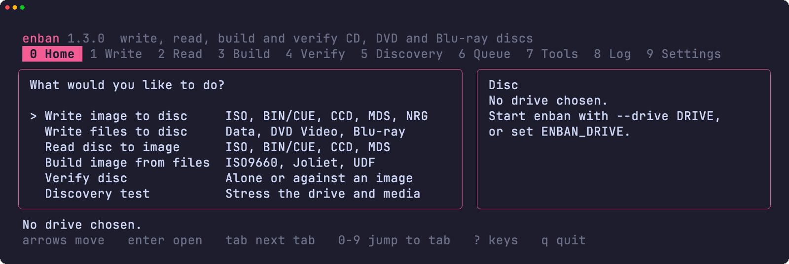<br><sub>Home，六个任务和光盘窗格</sub></td>
<td width="50%" valign="top">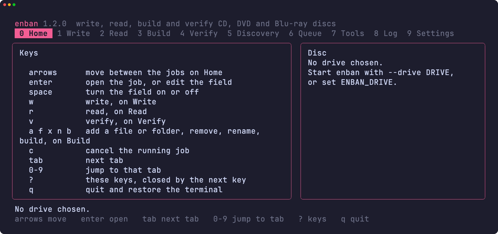<br><sub>按 ? 打开的按键列表</sub></td>
</tr>
<tr>
<td width="50%" valign="top">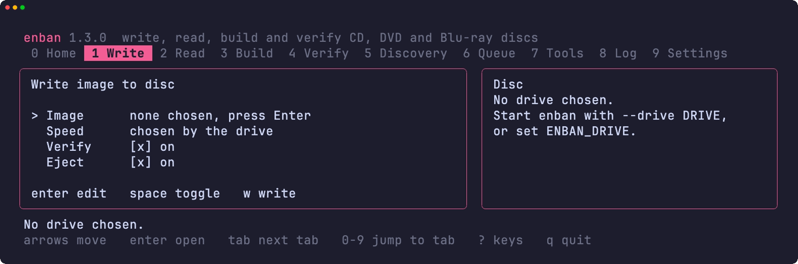<br><sub>Write 标签页，含镜像、速度、份数和开关</sub></td>
<td width="50%" valign="top">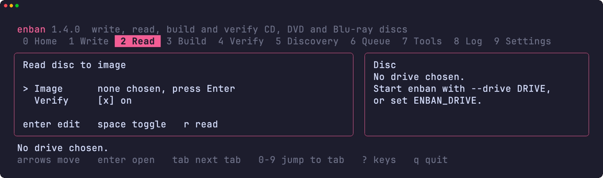<br><sub>Read 标签页，含镜像和校验字段</sub></td>
</tr>
<tr>
<td width="50%" valign="top">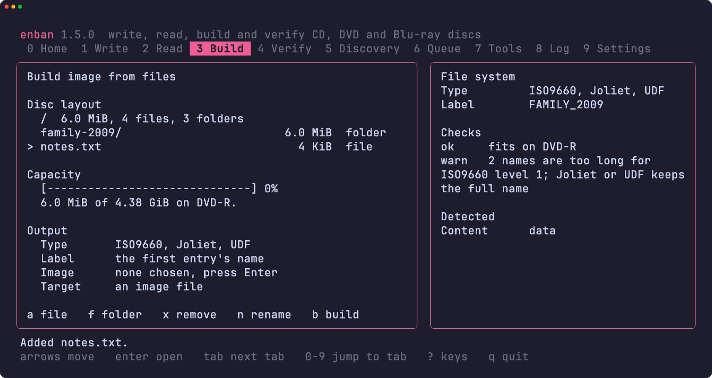<br><sub>Build 标签页，含光盘布局、容量、输出字段和文件系统检查</sub></td>
<td width="50%" valign="top">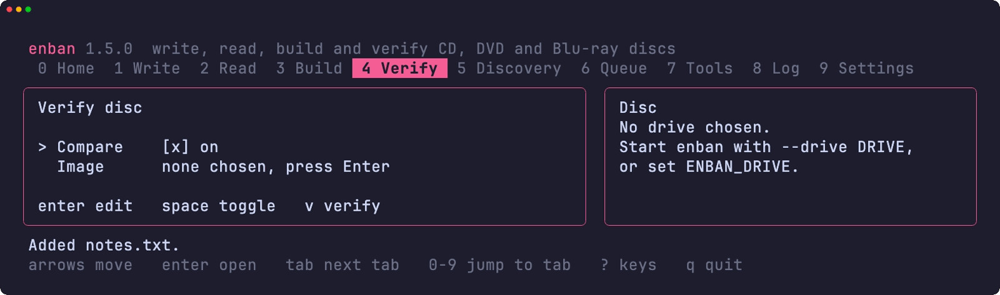<br><sub>Verify 标签页，含比对和镜像字段</sub></td>
</tr>
<tr>
<td width="50%" valign="top">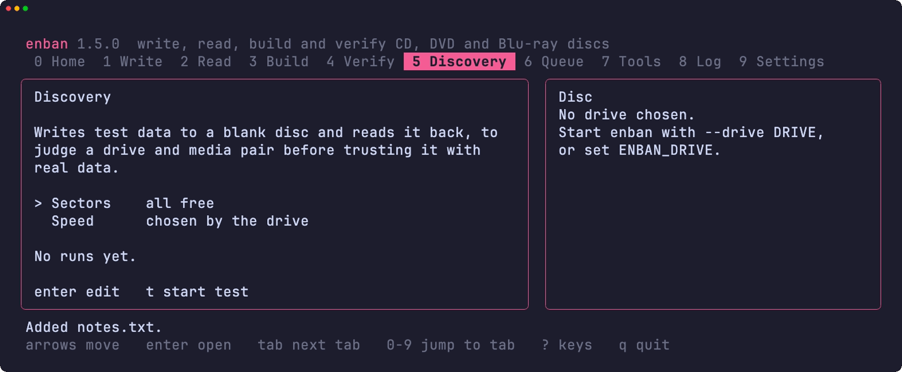<br><sub>Discovery 标签页，含扇区和速度字段</sub></td>
<td width="50%" valign="top">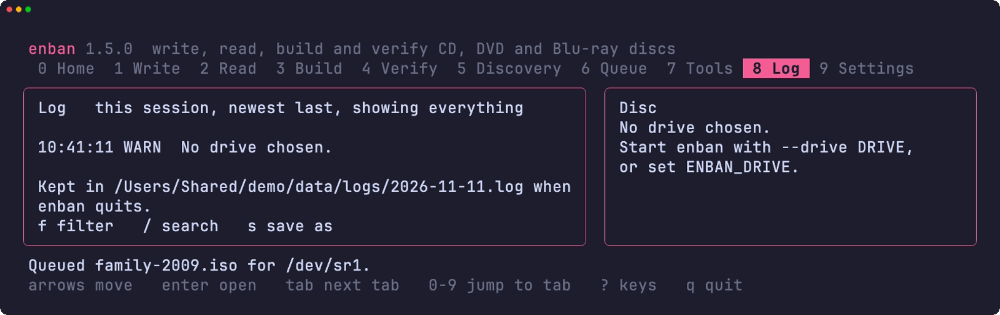<br><sub>Log 标签页，含本次会话的记录</sub></td>
</tr>
<tr>
<td width="50%" valign="top">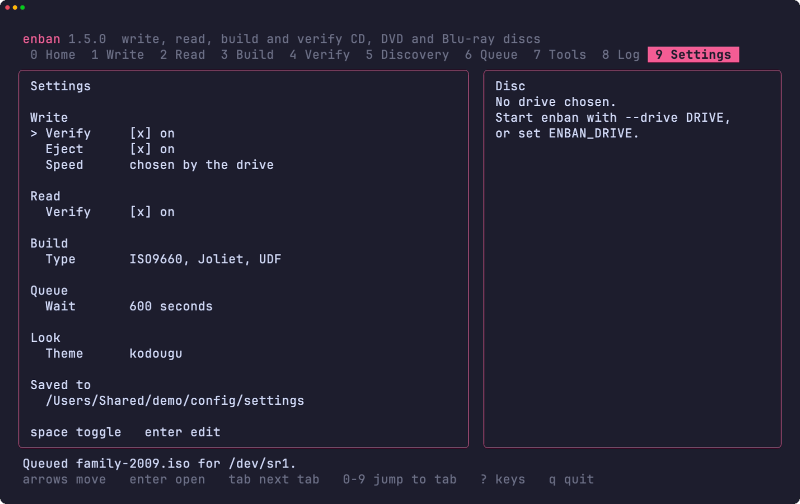<br><sub>Settings 标签页的 Write 页</sub></td>
<td width="50%" valign="top"></td>
</tr>
<tr>
<td width="50%" valign="top">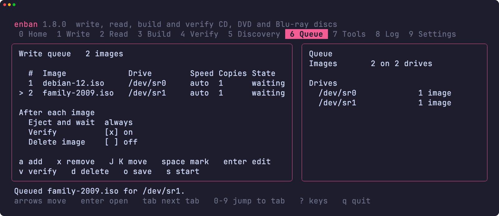<br><sub>Queue 标签页，两个镜像在等待光驱</sub></td>
<td width="50%" valign="top">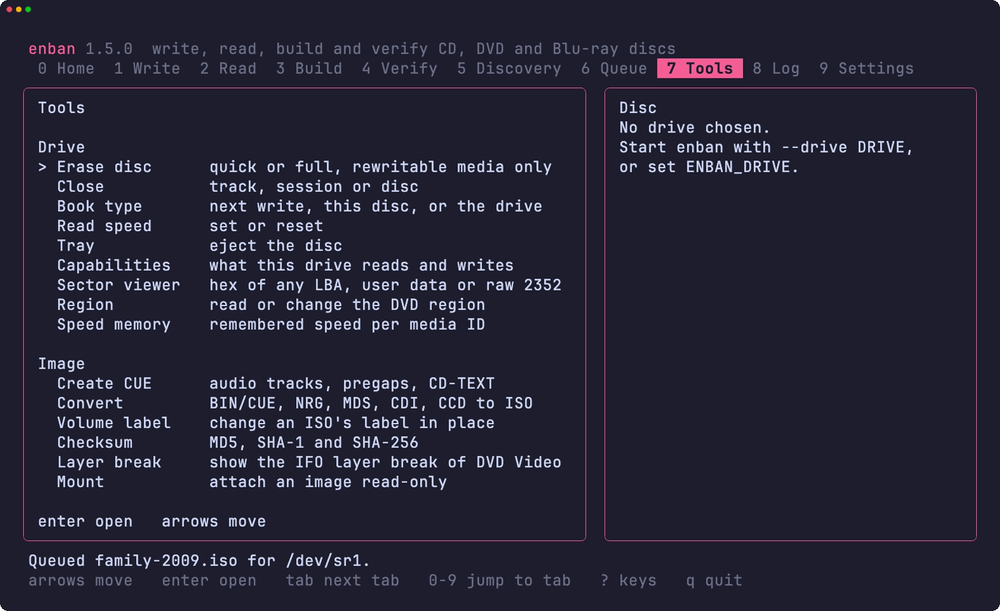<br><sub>Tools 标签页，含光驱和镜像工具</sub></td>
</tr>
<tr>
<td width="50%" valign="top">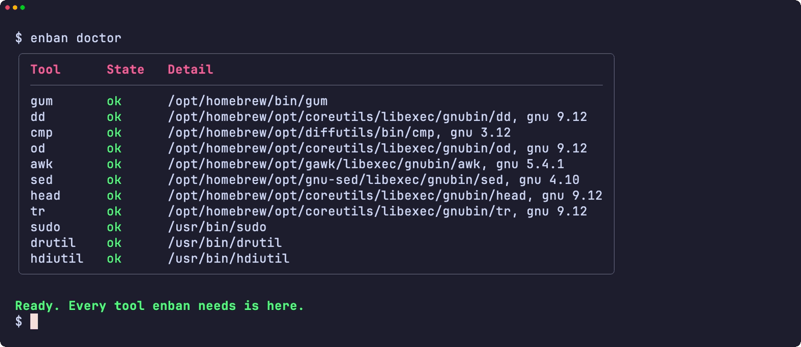<br><sub>doctor 检查所需的每个工具</sub></td>
<td width="50%" valign="top">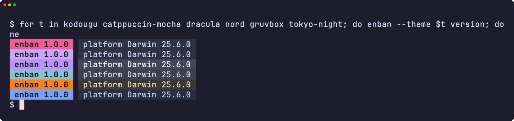<br><sub>六种主题下的版本标记</sub></td>
</tr>
<tr>
<td width="50%" valign="top">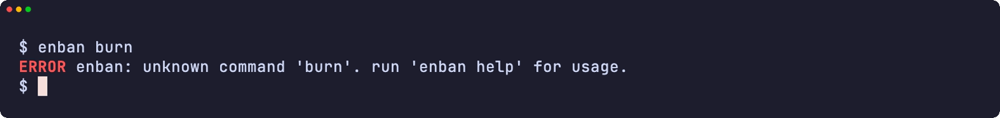<br><sub>错误</sub></td>
<td width="50%" valign="top">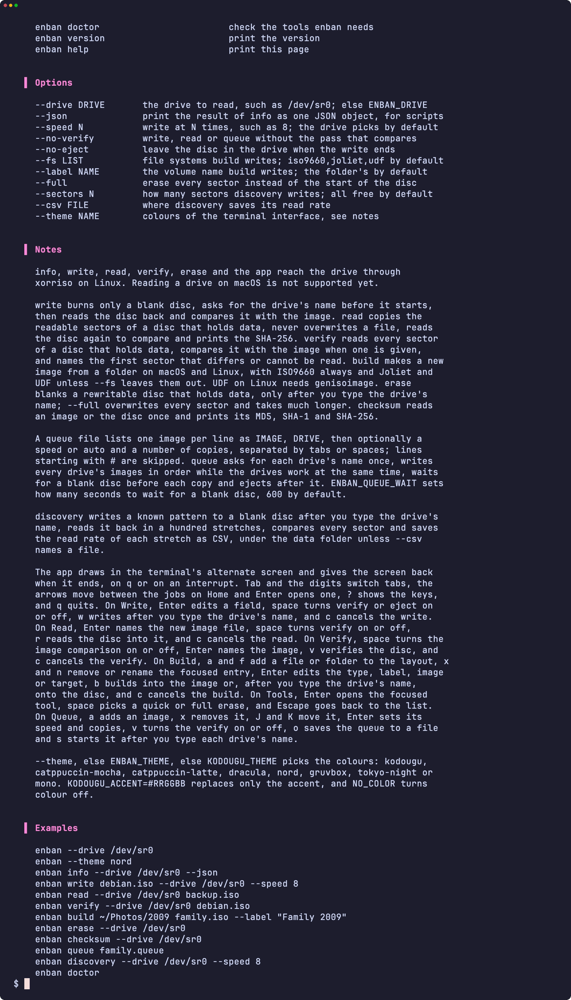<br><sub>帮助页面</sub></td>
</tr>
</table>

</details>

<a id="development"></a>

## 开发

| 命令 | 说明 |
|:--------|:------------|
| `make fmt` | 用 shfmt 格式化所有脚本 |
| `make lint` | shfmt、对所有脚本、测试和补全运行 ShellCheck，用 mandoc 检查 man 手册，用 yamllint 和 actionlint 检查工作流 |
| `make test` | 在系统 `sh` 下运行 `bats` 测试 |
| `make test-all` | 在每种 shell 下运行同样的测试 |
| `make test-linux` | 在 Ubuntu 容器中运行同样的测试 |
| `make coverage` | 合并这台 Mac 和 Ubuntu 容器中的 bashcov 行覆盖率，并执行 CI 同样的 100% 门槛 |
| `make screens` | 在 macOS 上用 VHS 从真实工具录制 README 界面 |

## 许可证

[MIT](LICENSE)
